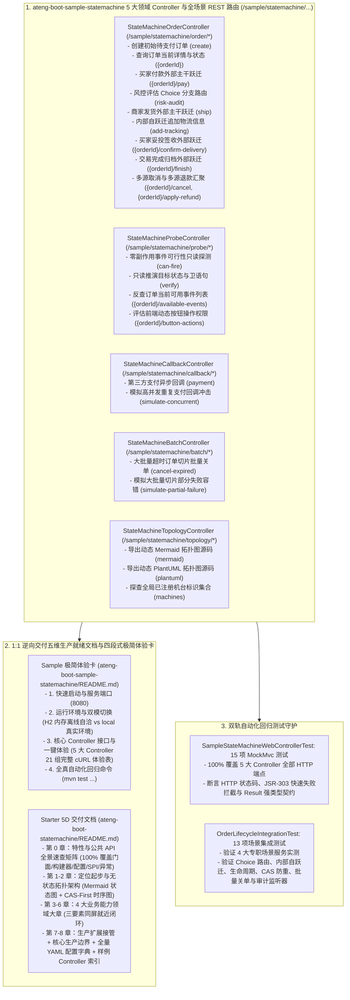

# 102. 业务状态机样例工程多控制器领域解耦、Web 体验化与五维规范重构架构决策 (StateMachine Sample Multi-Controller Domain Decoupling, Web Experience & 5D Documentation Architecture)

## 背景与痛点

在 [ADR-0051](./0051-high-performance-stateless-business-state-machine-architecture.md) 与 [ADR-0080](./0080-statemachine-full-scenario-hardening-and-resilient-governance-architecture.md) 中，框架确立了 `ateng-boot-statemachine` 基于纯原生 JDK 17 与 Spring 6 算力的高性能轻量无状态业务状态机底座，涵盖外部主干流转、内部自跃迁、多源汇聚、Choice 动态风控条件路由、状态节点 Entry/Exit 生命周期、零副作用纯只读预检探测（`canFire` / `verifyTransition` / `getAvailableEvents`）、CAS 乐观锁前置时序并发防重、声明式幂等放行（`idempotent(true)`）、Spring 本地事务提交后不可逆通知（`performAfterCommit`）、大批量切片流转引擎（`fireEventBatch`）、专职轨迹审计监听器 SPI（`StateTransitionAuditListener`）、执行切面拦截器 SPI（`StateMachineInterceptor`）及动态 Mermaid / PlantUML 状态拓扑导出等核心能力。

然而，在早期 [ADR-0080](./0080-statemachine-full-scenario-hardening-and-resilient-governance-architecture.md) 第 8 节的样例整改中，曾设立了一项局部的“纯净 Headless 非 Web 样例形态约定”，彻底移除了 Web Controller 与 Web 容器，仅依托 4 大专职 `ScenarioService` 与 `@SpringBootTest` 闭环。随着全框架架构的演进以及《工业级文档与样例工程标准规范》（[`docs/agents/documentation-specification.md`](../agents/documentation-specification.md)）的确立，既有方案暴露出以下结构性断层：

1. **开发者交互体验阻断 (Developer Experience Barrier)**：
   - 移除了 Web Controller 后，开发者启动 `ateng-boot-sample-statemachine` 样例工程后无法通过 HTTP/cURL 或 Postman 一键触发并直观体验任何状态机核心特性，极大抬高了学习、排查与联调门槛；
   - 违背了全框架统一定义的“多控制器领域交互体验（MultiControllerExperience）”规范契约（全仓库已有 30+ 样例工程如 `sample-redis`、`sample-rabbitmq`、`sample-mqtt`、`sample-pay`、`sample-encrypt` 均已严格对齐）。
2. **文档与代码脱节断层 (Documentation & Code Desynchronization)**：
   - 样例工程 `ateng-boot-sample-statemachine/README.md` 未采用规范的四段式极简体验卡结构，完全缺失立即可用的 cURL 体验命令表；
   - Starter `ateng-boot-statemachine/README.md` 缺少面向业务能力领域大章的收敛架构，各子特性小节未严格同屏闭环“专属 YAML + 真实 Sample Java + 机制边界”三要素。
3. **缺少传输契约与 JSR-303 防卫 (Missing Typed DTO Contracts & Validation)**：
   - 历史样例直接面向内部场景服务入参，缺乏面向 Web 接入层的强类型请求 DTO 与 JSR-303 第一道防线校验体系，缺少与持久层 ORM 实体（`OrderDO`）彻底隔离的展示层 VO。

---

## 核心决策与架构内容

立足于纯原生算力、零实体泄露（Zero-Entity-Leakage）与工业级代码成熟度九道防线，正式确立 **业务状态机样例工程多控制器领域解耦、Web 体验化与五维规范重构架构**：

### 1. 废除过时约定，全面推进 Web 体验化与 5 大高内聚领域控制器
- 正式废止早期 ADR-0080 中局部设定的“纯净 Headless 样例形态约定”，样例工程 `ateng-boot-sample-statemachine/pom.xml` 统一引入 `io.github.atengk:ateng-boot-web`；
- 按业务功能领域将样例工程拆分为 5 大高内聚 `@RestController`：
  1. `StateMachineOrderController`（`/sample/statemachine/order/*`）：覆盖电商订单全生命周期（创建、支付、风控评估、发货、追加物流轨迹、妥投、完结、取消及退款）；
  2. `StateMachineProbeController`（`/sample/statemachine/probe/*`）：覆盖零副作用只读预检探测（`canFire` / `verifyTransition` / `getAvailableEvents`）与前端动态操作按钮权限评估；
  3. `StateMachineCallbackController`（`/sample/statemachine/callback/*`）：覆盖第三方支付异步回调处理、CAS-First 乐观锁并发防重与高并发多线程冲突模拟；
  4. `StateMachineBatchController`（`/sample/statemachine/batch/*`）：覆盖超时订单大批量切片关单（`fireEventBatch`）与 Fail-Safe 局部异常容错隔离；
  5. `StateMachineTopologyController`（`/sample/statemachine/topology/*`）：覆盖 Mermaid / PlantUML 状态机拓扑图动态导出及全局注册表（`StateMachineFactory`）单例内省。
- 遵循 Zero-Entity-Leakage 契约，Controller 传输边界 100% 严禁暴露 ORM 实体（`OrderDO`），入参统一采用强类型 Request DTO（7 个 DTO 均标配 JSR-303 校验），出参统一显式返回强类型 `Result<T>` 配合 5 个领域 VO（`OrderVO`、`OrderTransitionVO`、`OrderButtonActionVO`、`OrderBatchResultVO`、`OrderConcurrentSimulationVO`）。

### 2. 1:1 逆向交付五维生产文档与四段式极简体验卡
- **Sample 极简体验卡**：重构 `ateng-boot-sample-statemachine/README.md`，聚焦端口启动（8080）、双模切换、21 组全场景 cURL 体验命令表与回归命令，彻底移除长篇架构原理抄录；
- **Starter 5D 权威文档**：重构 `ateng-boot-statemachine/README.md`，确立 8 大标准章节体系：
  - 第 0 章：特性与公共 API 全景速查矩阵（100% 覆盖门面、构建器、配置项、SPI 与异常体系，转义泛型字符）；
  - 第 1~2 章：模块定位快速起步与无状态单例架构拓扑（集成订单状态流转图与 CAS-First 执行时序图）；
  - 第 3~6 章：4 大业务能力领域大章（DSL 规则编排套件、只读预检探测套件、CAS 乐观锁防重与事务同步套件、大批量切片流转与可观测性套件），每个子小节均严格在同一屏幕内闭环“专属 YAML + 真实 Sample Java + 机制边界”三要素；
  - 第 7~8 章：生产扩展接管、核心生产边界、全量 YAML 配置字典及 Sample Controller 路由映射附录。

### 3. 双轨全真自动化回归测试守护
- 交付 `SampleStateMachineWebControllerTest`：包含 15 项全场景 MockMvc 测试，100% 覆盖 5 大 Controller 的全部 HTTP 端点，断言 HTTP 状态码、JSR-303 快速失败拦截与 `Result<T>` 强类型契约；
- 保留并调优 `OrderLifecycleIntegrationTest`：包含 13 项场景集成测试，专职断言 4 大专职场景服务、CAS-First 乐观锁前置时序并发防重、`performAfterCommit` 本地事务后钩子、大批量切片流转以及 `StateTransitionAuditListener` 轨迹审计监听器。

---

## 后果与权衡 (Consequences)

### 正向收益
1. **端到端一键可交互体验**：开发者启动 Sample 即可通过标准 HTTP/cURL 端点直观体验状态机全部流转特性、只读探测与拓扑导出，极大降低上手门槛。
2. **传输契约与持久层绝对解耦**：7 个强类型 Request DTO 与 4 个业务 VO 彻底阻断 `OrderDO` 泄漏，严格遵守分层双防校验体系。
3. **文档与代码 100% 真实对齐**：所有文档示例与配置 100% 逆向提取自实测全绿的 Sample 源码，彻底消除文档欺骗。

### 妥协成本
- 样例工程需额外引入 `ateng-boot-web` 与 JSR-303 依赖，增加了少量的内存占用（但在 H2 纯内存自洽环境下仍保持毫秒级启动与秒级测试完成）。
