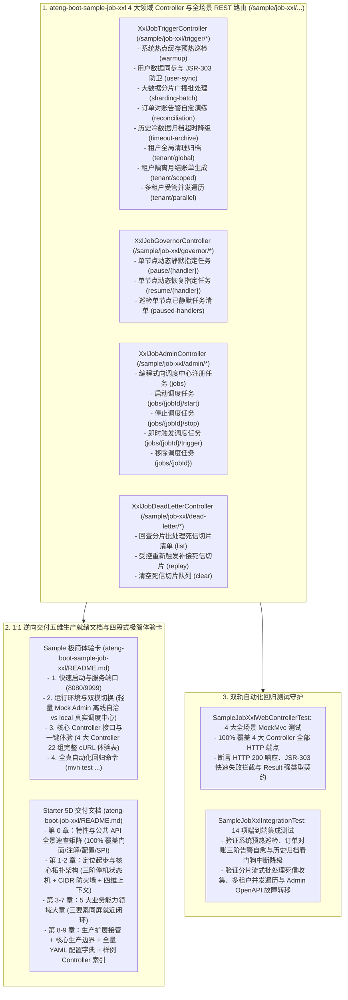

# 103. XXL-Job 分布式任务调度样例工程多控制器领域解耦、Web 体验化与五维规范重构架构决策 (XXL-Job Sample Multi-Controller Domain Decoupling, Web Experience & 5D Documentation Architecture)

## 背景与痛点

在 [ADR-0075](./0075-xxl-job-production-hardening-and-distributed-scheduling-architecture.md) 与 [ADR-0082](./0082-xxl-job-full-scenario-hardening-interceptor-lifecycle-and-resilient-batch-architecture.md) 中，框架确立了 `ateng-boot-job-xxl` 基于官方 `xxl-job-core:3.5.0`（原生 Spring Boot 3 与 JDK 17 基线）的分布式调度生产加固底座，涵盖方法级高阶注解 `@AtengXxlJob`、四维上下文透传（`AsyncContext` / MDC `traceId` / 租户模式）、SLF4J 动态日志双写镜像（`XxlJobLogbackAppender`）、本地硬看门狗超时强中断与两级降级补偿、任务切面责任链拦截器 SPI（`XxlJobInterceptor`）、节点级任务运行时治理总线（`JobRuntimeGovernor`）、强类型 DTO 入参与 JSR-303 防卫、大数据分片流式批处理模板（`XxlShardingBatchTemplate`，含 `FailedBatch` 死信切片收集与进度打卡）、多租户受管并发遍历（`TenantJobTemplate.executeForEachTenantParallel`）、K8s 停机三阶平滑排空状态机、端口防冲突自愈与 CIDR 安全防火墙、三阶告警风暴抑制自愈状态机，以及脱网调试门面 `XxlJobTestHelper` 等核心能力。

然而，对照框架权威规约《工业级文档与样例工程标准规范》（[`docs/agents/documentation-specification.md`](../agents/documentation-specification.md)）核验时，发现既有工程与文档存在以下结构性断层：

1. **样例工程 Controller 缺失与 Web 体验断层 (Developer Experience Barrier)**：
   - 样例工程 `ateng-boot-sample-job-xxl` 虽在 `pom.xml` 中引入了 `ateng-boot-web` 依赖，但内部缺少面向外部交互的 `@RestController`，开发者无法通过 HTTP/cURL 直观验证与体验调度触发、节点治理、集群管理与死信运维；
   - 违背了全框架统一定义的“被动监听类由 Controller 提供手动触发端与死信/待决状态查询运维端”与“多 Controller 领域解耦”规范要求。
2. **样例极简体验卡缺失 (Missing Sample Experience Card)**：
   - 样例工程根目录下完全缺失 `README.md`，未提供规范的四段式极简体验卡，无法获得开箱即用的 cURL 命令速查表。
3. **Starter 契约文档未按能力大章收敛与三要素割裂 (Documentation & Code Desynchronization)**：
   - 既有 `ateng-boot-job-xxl/README.md` 将全部功能扁平塞入第 3 章“生产扩展接管”，未按业务能力领域收敛为一级大章；
   - 各子特性小节严重缺失专属局部 YAML 配置片段，违背了“专属 YAML + 真实 Sample Java + 机制边界说明”三要素同屏就近闭环的刚性铁律，且文末缺少全量 YAML 配置字典。
4. **业务语义测试桩残留 (Test Stub Smells)**：
   - 样例任务中存在 `simpleGreetingJob`、`alertDemoJob`、`timeoutFallbackDemoJob` 等纯测试桩命名，未演进为贴合真实企业生产级的高频业务模型。

---

## 核心决策与架构内容

立足于纯原生算力、零实体泄露（Zero-Entity-Leakage）与工业级代码成熟度九道防线，正式确立 **XXL-Job 分布式任务调度样例工程多控制器领域解耦、Web 体验化与五维规范重构架构**：

### 1. 落地 4 大高内聚领域控制器与契约解耦
- 按业务能力将样例工程拆分为 4 大专职 `@RestController`：
  1. `XxlJobTriggerController`（`/sample/job-xxl/trigger/*`）：负责任务的手动模拟驱动，覆盖轻量预热、参数校验、分片广播、订单对账告警自愈、超时归档就地降级补偿与多租户全模态隔离；
  2. `XxlJobGovernorController`（`/sample/job-xxl/governor/*`）：负责单节点维度的任务内存动态静默、恢复与静默状态巡检；
  3. `XxlJobAdminController`（`/sample/job-xxl/admin/*`）：负责通过编程式门面调用官方 OpenAPI，完成任务的新增、启停、即时触发与删除；
  4. `XxlJobDeadLetterController`（`/sample/job-xxl/dead-letter/*`）：负责流式批处理失败切片的内存收集、明细回查、受控重放补偿与现场清理。
- 遵循 Zero-Entity-Leakage 契约，Controller 传输边界 100% 严禁暴露持久层 Entity，入参统一采用强类型 Request DTO（`UserSyncParam`、`AdminJobAddRequestDTO`），出参统一显式返回强类型 `Result<T>` 配合 2 个领域 VO（`JobTriggerVO`、`DeadLetterBatchVO`）。

### 2. 真实业务模型演进与测试桩清零
- 彻底废除既有测试桩命名，升级为贴合真实企业级生产场景的业务模型：
  - `simpleGreetingJob` 演化为 `systemWarmupJob` (系统冷启动热点缓存预热与健康巡检)；
  - `alertDemoJob` 演化为 `orderReconciliationJob` (电商每日订单对账差错告警与平账自愈)；
  - `timeoutFallbackDemoJob` 演化为 `historyDataArchiveJob` (历史冷数据归档超时看门狗中断与就地降级补偿)；
  - 保留并强化已有的 `userSyncJob`、`shardingBatchDeadLetterJob`、`globalArchiveJob`、`tenantScopedJob`、`parallelTenantJob`。

### 3. 双轨全真自动化回归测试守护
- 交付 `SampleJobXxlWebControllerTest`：使用 `MockMvc` 对 4 大 Controller 的全部 HTTP 端点进行 100% 覆盖测试，断言 HTTP 状态码 200、`Result<T>` 序列化契约与 JSR-303 Fail-Fast 快速拦截；
- 升级 `SampleJobXxlIntegrationTest`：对齐新业务任务命名，守护四维上下文透传、死信捕获、多租户并发遍历、三阶告警聚合状态机与轻量离线 Mock Admin 双模自适应机制。

### 4. 1:1 逆向交付五维生产就绪文档与四段式体验卡
- **Sample 极简体验卡**：新建 `ateng-boot-sample-job-xxl/README.md`，聚焦端口启动（8080/9999）、双模切换、22 组全场景 cURL 体验命令表与回归命令，彻底移除长篇架构原理抄录；
- **Starter 5D 权威文档**：重构 `ateng-boot-job-xxl/README.md`，确立 10 大标准章节体系（第 0 章全景矩阵、第 1~2 章定位起步与架构拓扑、第 3~7 章 5 大业务能力大章【三要素同屏就近闭环】、第 8~9 章生产扩展接管与全量 YAML 配置字典）。

---

## 后果与权衡 (Consequences)

### 正向收益
1. **端到端一键可交互体验**：开发者启动 Sample 即可通过标准 HTTP/cURL 端点直观体验分布式任务调度全部特性、节点级动态治理、调度中心 OpenAPI 与分片死信运维，大幅降低认知与上手门槛。
2. **传输契约与持久层绝对解耦**：强类型 Request DTO 与业务 VO 彻底阻断模型泄漏，严格守卫分层双防校验体系。
3. **文档与代码 100% 真实对齐**：所有文档示例与配置 100% 逆向提取自实测全绿的 Sample 源码，彻底消除文档欺骗与 404 伪指令。

### 妥协成本
- 样例工程新增了 Controller 接入层与 Web 测试套件，轻微增加了构建编译耗时，但在轻量 Mock Admin 离线自洽环境下仍保持秒级测试完成。
