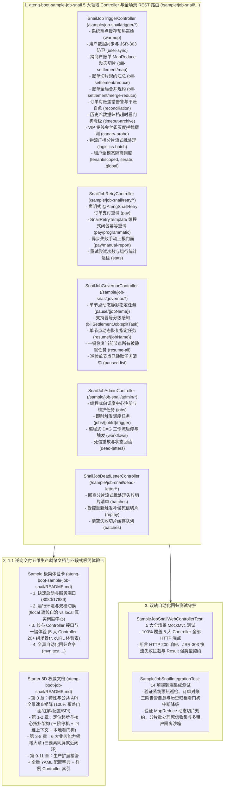

# 104. SnailJob 分布式调度与协同重试样例工程多控制器领域解耦、Web 体验化与五维规范重构架构决策 (SnailJob Sample Multi-Controller Domain Decoupling, Web Experience & 5D Documentation Architecture)

## 背景与痛点

在 [ADR-0076](./0076-snail-job-dual-engine-production-hardening-and-resilient-distributed-architecture.md) 中，框架确立了 `ateng-boot-job-snail` 基于官方 `snail-job-client-starter:1.10.0`（原生 Spring Boot 3 与 JDK 17 基线）的双擎分布式调度与协同重试加固基础设施，涵盖方法级高阶注解 `@AtengSnailJob` 与 `@AtengSnailRetry`、四维全链路上下文透传与远程重试保真还原（`AsyncContext` / MDC `traceId` / 租户模式 / 操作人）、SLF4J 动态日志双写镜像（`SnailJobLogbackAppender`）、本地硬看门狗超时强中断与同 Bean 就地降级补偿（`fallbackMethod`）、MapReduce 动态分布式切片规约、调度生命周期责任链拦截器 SPI（`SnailJobInterceptor`）、节点级任务运行时治理总线（`SnailJobRuntimeGovernor`）、强类型 DTO 入参与 JSR-303 防卫、大数据分片流式批处理模板（`SnailShardingBatchTemplate`，含 `FailedBatch` 死信切片收集与进度追溯）、多租户隔离遍历模板（`TenantJobTemplate`）、编程式分布式重试门面（`SnailRetryTemplate`）、OpenAPI 编程式管理门面（`SnailJobAdminTemplate`）、K8s 停机三阶平滑排空状态机（`GracefulDrainStateMachine`）、三阶告警风暴抑制自愈状态机，以及脱网调试门面 `SnailJobTestHelper` 等核心能力。

然而，对照框架权威规约《工业级文档与样例工程标准规范》（[`docs/agents/documentation-specification.md`](../agents/documentation-specification.md)）核验时，发现既有工程与文档存在以下结构性断层：

1. **样例工程 Controller 缺失与 Web 体验断层 (Developer Experience Barrier)**：
   - 受早期局部“移除 Sample Web Controller、仅保留后台 ScenarioService”的过时约定影响，既有样例工程 `ateng-boot-sample-job-snail` 未引入 `ateng-boot-web` 且完全缺失面向外部交互的 `@RestController`，开发者在启动样例后无法通过 HTTP/cURL/Swagger 直观验证与体验调度触发、MapReduce 计算、协同重试、节点治理、OpenAPI 运维与死信补偿；
   - 严重违背了全框架统一定义的“被动监听类由 Controller 提供手动触发端与死信/待决状态查询运维端”与“多 Controller 领域解耦”核心规范要求。
2. **样例极简体验卡缺失 (Missing Sample Experience Card)**：
   - 样例工程根目录下未提供规范的四段式极简体验卡 `README.md`，开发者无法快速获知 Web 端口（8080）与 RPC 端口（17889）信息，缺少开箱即用的场景化 cURL 命令速查表与双模环境切换指引。
3. **Starter 契约文档未按能力大章收敛与三要素同屏割裂 (Documentation & Code Desynchronization)**：
   - 既有 `ateng-boot-job-snail/README.md` 虽有全景矩阵，但正文未严格遵循“业务能力领域大章”收敛架构，各子特性小节严重缺失局部专属 YAML 配置片段，违背了“专属 YAML + 真实 Sample Java + 机制边界说明”三要素同屏就近闭环的刚性铁律，且文末缺少全量 YAML 配置字典。
4. **业务语义测试桩残留 (Test Stub Smells)**：
   - 样例任务中仍存在 `simpleGreetingJob`、`alertDemoJob`、`timeoutFallbackJob`、`mapReduceDemoJob` 等缺乏业务实际场景的技术测试桩命名，未演进为贴合企业真实生产级的高频业务模型。
5. **领域词汇陈旧与概念冲突 (Obsolete Glossary Terms)**：
   - 子模块词汇表 `CONTEXT.md` 首段仍写有“遵循非 Web 中间件底座‘零 Controller 不变量’”，与当前全框架统一实施的多 Controller 架构存在直接概念冲突。

---

## 核心决策与架构内容

立足于纯原生算力、零实体泄露（Zero-Entity-Leakage）与工业级代码成熟度九道防线，正式确立 **SnailJob 分布式调度与协同重试样例工程多控制器领域解耦、Web 体验化与五维规范重构架构**：

### 1. 落地 5 大高内聚领域控制器与契约解耦
- 统一在 `ateng-boot-sample-job-snail/pom.xml` 中引入 `ateng-boot-web` 模块，按业务能力拆分为 5 大专职 `@RestController`：
  1. `SnailJobTriggerController`（`/sample/job-snail/trigger/*`）：负责任务手动模拟驱动，覆盖系统预热巡检、强类型入参同步、MapReduce 三阶切片规约、订单对账告警平账自愈、超时归档看门狗降级、金丝雀灰度探测、物流广播分片与多租户全模态隔离；
  2. `SnailJobRetryController` (`/sample/job-snail/retry/*`)：负责分布式协同重试演练，覆盖声明式注解重试、编程式幂等重试、异步失败手动上报及重试统计查询；
  3. `SnailJobGovernorController`（`/sample/job-snail/governor/*`）：负责单节点维度的任务内存动态暂停、恢复、冒号分级感知（如 `billSettlementJob:splitTask`）与静默状态巡检；
  4. `SnailJobAdminController`（`/sample/job-snail/admin/*`）：负责通过编程式门面调用 SnailJob 官方 OpenAPI，完成任务生命周期管理、DAG 工作流启停与死信重放；
  5. `SnailJobDeadLetterController`（`/sample/job-snail/dead-letter/*`）：负责流式批处理失败切片的内存收集、明细回查、受控重放补偿与现场清理。
- 遵循 Zero-Entity-Leakage 契约，Controller 传输边界 100% 严禁暴露持久层 Entity，入参统一采用强类型 Request DTO（`UserSyncParam`、`JobTriggerRequestDTO`、`BillSettlementRequestDTO`、`OrderPayRetryRequestDTO` 等），出参统一显式返回强类型 `Result<T>` 配合业务 VO（`JobTriggerVO`、`RetryExecutionVO`、`GovernorStatusVO`、`DeadLetterBatchVO`）。

### 2. 真实业务模型演进与测试桩清零
- 彻底废除既有测试桩命名，升级为贴合真实企业生产级的高频业务模型：
  - `simpleGreetingJob` 演化为 `systemWarmupJob` (系统冷启动热点缓存预热与健康巡检)；
  - `canaryBypassJob` 演化为 `vipChannelProbeJob` (VIP 专属交易专线健康探测金丝雀灰度任务)；
  - `alertDemoJob` 演化为 `orderReconciliationJob` (电商每日订单对账差错告警与平账自愈)；
  - `timeoutFallbackJob` 演化为 `historyDataArchiveJob` (海量历史交易冷数据归档超时看门狗中断与就地降级补偿)；
  - `mapReduceDemoJob` 演化为 `billSettlementJob` (跨商户月度账单分布式 Map 切片拆分、Reduce 规约汇总与 MergeReduce 全局合并)；
  - `shardingBatchJob` 演化为 `logisticsStatusSyncJob` (物流在途轨迹多节点广播分片流式批处理)；
  - 保留并强化已有的 `userSyncJob`（强类型 JSR-303 防卫）、`tenantBatchJob`（多租户沙箱遍历）与 `orderPayRetry`（订单支付协同重试）。

### 3. 双模自洽与双轨全真自动化回归测试守护
- **离线 Mock Admin 桩与双模切换**：
  - 调度与重试业务完全依托内存 `SnailJobTestHelper` 反射驱动，在 `!local` 离线环境下保持 100% 独立自洽运行；
  - 调度中心 OpenAPI 管理通过 `@TestConfiguration` + `@Profile("!local")` 注入轻量离线 Mock Admin 桩进行 HTTP 响应仿真，确保 CI 脱机环境下无网络依赖；
  - 提供 `application-local.example.yml` 大写占位符模板，激活 `local` Profile 启动即可直连真实 SnailJob 服务端。
- **双轨自动化测试套件**：
  - 交付 `SampleJobSnailWebControllerTest`：使用 `MockMvc` 对 5 大 Controller 的全部 HTTP 端点进行 100% 覆盖测试，断言 HTTP 状态码 200、`Result<T>` 序列化契约与 JSR-303 Fail-Fast 快速拦截；
  - 升级 `SampleJobSnailIntegrationTest`：对齐新业务模型方法命名，全面守护四维上下文透传、三阶平滑停机排空状态机、三阶告警风暴抑制聚合自愈、MapReduce 切片汇总与死信通道。

### 4. 1:1 逆向交付五维生产就绪文档与四段式体验卡
- **Sample 极简体验卡**：新建 `ateng-boot-sample-job-snail/README.md`，聚焦 Web 8080 与 RPC 17889 端口启动、双模切换、20+ 组全场景 cURL 体验命令表与全真回归命令，彻底移除长篇架构原理抄录；
- **Starter 5D 权威文档**：按照 12 大标准化大纲体系全面重构 `ateng-boot-job-snail/README.md`，确立全景矩阵 100% 覆盖、第 3~8 章 6 大业务能力大章【专属 YAML + 真实 Sample Java + 机制边界同屏就近闭环】、生产扩展接管与全量 YAML 配置字典速查附录。

### 5. 领域词汇表治理与术语废立
- 彻底修订 `ateng-boot-job-snail/CONTEXT.md`，清理“遵循非 Web 中间件底座‘零 Controller 不变量’”等陈旧表述；
- 补充 5 大专职 Controller 领域概念与 DTO/VO 术语定义，并维护 `CONTEXT-MAP.md` 与 `docs/adr/README.md` 索引看板。

---

## 后果与权衡 (Consequences)

### 正向收益
1. **端到端一键可交互体验**：开发者启动 Sample 即可通过标准 HTTP/cURL 端点直观体验分布式任务调度、MapReduce 计算、协同重试、节点级动态治理、OpenAPI 运维与死信运维全部特性，大幅降低理解与上手门槛。
2. **传输契约与持久层绝对解耦**：强类型 Request DTO 与业务 VO 彻底阻断 ORM 实体泄露，严格守卫 JSR-303 第一道防线与分层双防校验体系。
3. **文档与代码 100% 真实对齐**：所有文档示例与配置 100% 逆向提取自实测全绿的 Sample 源码，彻底消除文档欺骗与 404 伪指令。
4. **领域术语唯一真理源纯净**：废除过时冲突词汇，确立统一的领域契约。

### 妥协成本
- 样例工程新增了 Controller 接入层与 Web 测试套件，轻微增加了构建编译耗时，但在轻量 Mock Admin 离线自洽环境下仍保持秒级测试完成。
