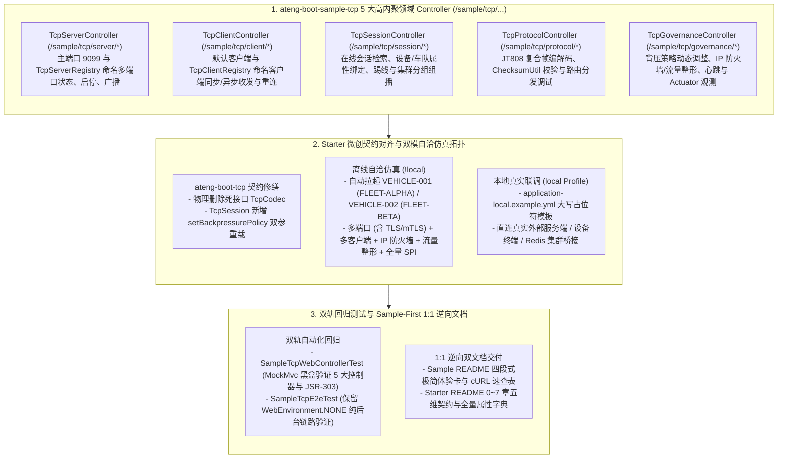

# 105. TCP 网络通信样例工程多控制器领域解耦、双模闭环与五维规范重构架构决策 (TCP Sample Multi-Controller Domain Decoupling, Dual-Mode Closed Loop & 5D Documentation Architecture)

## 背景与痛点

在 [ADR-0054](./0054-industrial-grade-dual-mode-tcp-networking-architecture.md) 与 [ADR-0083](./0083-tcp-full-scenario-hardening-backpressure-and-resilient-governance-architecture.md) 中，框架确立了 `ateng-boot-tcp` 基于 Netty 4.1.x 构建的工业级双模长连接通信底座，完整落地了服务/客户双模协同、多端口多协议监听（`TcpServerRegistry`）、多命名客户端路由（`TcpClientRegistry`）、双向 mTLS 证书握手、配置驱动粘包拆包切片、工业报文清洗过滤（`TcpPacketFilter` / `ChecksumUtil`）、全双工 Request-Response RPC、高低水位出站背压守卫（`WriteBufferWaterMark` / `FAIL_FAST`）、IP 访问控制防火墙、全局/单连接流量整形与跨节点集群分组组播（`TcpClusterBridge`）。

然而，对照框架权威规约《工业级文档与样例工程标准规范》（[`docs/agents/documentation-specification.md`](../agents/documentation-specification.md)）逐项审计后，发现 `ateng-boot-tcp` 与 `ateng-boot-samples/ateng-boot-sample-tcp` 在体验闭环、契约一致性与文档准确性层面存在以下结构性断层：

1. **样例工程沿用过时的“零 Controller 铁律” (Developer Experience Barrier)**：
   - 受早期 [ADR-0083](./0083-tcp-full-scenario-hardening-backpressure-and-resilient-governance-architecture.md) 第 5 节“移除 Sample Web Controller、仅保留后台 `VehicleTelemetryScenarioService`”局部约定约束，`ateng-boot-sample-tcp` 未引入 `ateng-boot-web` 与对外 HTTP 控制面；开发者启动样例后无法通过标准 REST API / cURL 体验多端口启停、命名客户端收发、在线会话治理、JT808 编解码与背压策略调优，严重违背全框架现行“多控制器领域交互体验”规范。
2. **YAML 配置键名错配导致属性静默失效 (Configuration Key Drift)**：
   - `TcpIdleProperties` 的真实绑定字段为 `readerIdleTime`、`writerIdleTime` 与 `allIdleTime`（对应 kebab-case 键名 `reader-idle-time`、`writer-idle-time`、`all-idle-time`），但既有 `ateng-boot-tcp/README.md` 与 `ateng-boot-sample-tcp` 配置文件错写为 `idle.reader-idle`、`idle.writer-idle`、`idle.all-idle`，导致空闲保活阈值在配置绑定阶段静默失效。
3. **未接线死 SPI 与幽灵 API 误导开发者 (Dead SPI & Phantom APIs)**：
   - 早期设计的 `TcpCodec` 接口在全库中拥有零业务调用与零自动装配接线（Dead SPI），却仍在 `ateng-boot-tcp/README.md` 与 [ADR-0054](./0054-industrial-grade-dual-mode-tcp-networking-architecture.md) 中作为核心扩展点介绍；
   - Starter 文档还存在实际不存在的 `TcpClientTemplate.use()` 与 `getClientRegistry()` 幽灵调用示例，未指向真正的多客户端注册中心 `TcpClientRegistry`；同时 `TcpSession` 缺少双参便捷背压设置重载。
4. **样例场景覆盖不全与四段式体验卡缺失 (Incomplete Sample Coverage)**：
   - 既有样例主要验证单一回环路径，尚未在自洽拓扑中充分串联主端口、命名多端口（含二进制与 TLS/mTLS）、命名多客户端、IP 防火墙、流量整形、全量活跃 SPI 及集群桥接，且缺失面向多控制器的四段式极简体验卡与双模切换模板 `application-local.example.yml`。
5. **Starter 五维契约与领域词汇表失调 (5D Spec & Glossary Gap)**：
   - 既有 `ateng-boot-tcp/README.md` 未建立 0~7 章五维结构，缺失 100% 全景速查矩阵、大章收敛与“专属 YAML + 真实 Java + 边界说明”同屏三要素闭环，且未明确区分 Sample 级扩展 `Jt808CompositeFrameCodec` 与 Starter 原语边界；`ateng-boot-tcp/CONTEXT.md` 亦缺少 `TcpServerRegistry`、`TcpPayload`、`Heartbeat Keep-Alive` 与 `Exponential Backoff Reconnect` 等权威词条界定。

---

## 核心决策与架构内容

秉承纯原生、零臃肿与 Zero-Entity-Leakage 传输契约原则，正式确立 **TCP 通信底座样例工程多控制器领域解耦、双模闭环与五维规范重构架构**：

### 1. 废止零 Controller 局部约定，落地 5 大领域 Controller（Zero-Entity-Leakage）
- 显式取代 [ADR-0083](./0083-tcp-full-scenario-hardening-backpressure-and-resilient-governance-architecture.md) 第 5 节“移除 Sample Web Controller”局部约定（同时对齐全域 [文档与样例工程标准规范](../agents/documentation-specification.md) 与 [ADR-0099](./0099-mqtt-sample-web-experience-and-documentation-specification-architecture.md) 先例），在 `ateng-boot-sample-tcp/pom.xml` 引入 `ateng-boot-web`；
- 按领域职责拆分为 5 大高内聚 `@RestController`（统一 `/sample/tcp/<feature>/<action>` 路由，严格采用 JSR-303 Request DTO 入参与强类型 `Result<T>` + 业务 VO 出参，100% 阻断 `TcpSession` / Netty `Channel` 等底层连接对象或实体直接泄露到 HTTP 边界）：
  1. `TcpServerController`：负责主端口（`9099`）与 `TcpServerRegistry` 命名多端口生命周期状态、定向推送与全局广播；
  2. `TcpClientController`：负责默认客户端与 `TcpClientRegistry` 命名客户端的连接观测、主动重连、单向发送与全双工 RPC 调用；
  3. `TcpSessionController`：负责在线会话巡检、设备/车队绑定属性读写、合规踢线下线与基于 `TcpClusterBridge` 的集群广播/组播；
  4. `TcpProtocolController`：负责车联网国标 JT/T 808 复合编解码演示、`ChecksumUtil` 校验和计算比对及 `BinaryOffsetRouteKeyExtractor` / `TcpDispatcher` 分发演练；
  5. `TcpGovernanceController`：负责动态背压流控策略调整（实测调用 `TcpSession` 双参重载）、IP 访问控制规则演示、流量整形吞吐观测、心跳状态与 `TcpActuatorEndpoint` 运维指标采集。

### 2. Starter 微创契约修缮与配置正名
- **物理清理死 SPI**：彻底删除全库零代码引用的 `TcpCodec` 接口并在 [ADR-0054](./0054-industrial-grade-dual-mode-tcp-networking-architecture.md) 补充退场注记，编解码与转义清洗统一定位到活跃原语 `TcpPayloadCodecHandler`、`TcpPayload`、`TcpPacketFilter`、`ChecksumUtil` 与 `TcpChannelCustomizer`；
- **补齐向后兼容的 `TcpSession` 双参背压重载**：在保留既有三参完整控制方法的前提下，新增 `setBackpressurePolicy(BackpressurePolicy, Duration)` 便捷重载，满足常规生产动态流控调整与编译兼容性；
- **严格纠正配置键名与客户端入口（零别名债务）**：`TcpIdleProperties` 保持强类型字段 `readerIdleTime` / `writerIdleTime` / `allIdleTime`，直接将文档与样例配置中的错误写法修正为 `reader-idle-time` / `writer-idle-time` / `all-idle-time`，拒绝引入弃用配置别名；统一以 `TcpClientRegistry.getRequiredTemplate` / `getRequiredClient` 替代文档中虚构的 `TcpClientTemplate.use()` / `getClientRegistry()`。

### 3. 全特性双模拓扑与 `@Profile("!local")` 离线自洽闭环
- 在样例配置与组件中 100% 实证主端口、多端口（含二进制协议栈与 TLS/mTLS）、默认与命名客户端、IP 防火墙、流量整形、集群桥接（支持 `RedisPubSubTcpClusterBridge`）及全部活跃 SPI；
- 离线默认模式（`@Profile("!local")`）自动拉起 2 台仿真车载终端：`VEHICLE-001`（所属车队 `FLEET-ALPHA`）与 `VEHICLE-002`（所属车队 `FLEET-BETA`），完成握手注册、周期上报、下行指令响应与集群组播自闭环；
- 配齐 `application-local.example.yml` 大写占位符模板并通过 `spring.config.import: "optional:classpath:application-local.yml"` 支持激活 `local` 后关闭离线仿真终端、直连真实设备与 Redis 集群。

### 4. Sample-First 1:1 逆向五维文档与双轨测试守护
- **双轨自动化测试**：新增 `SampleTcpWebControllerTest`（基于 `MockMvc` 覆盖 5 大 Controller 全部 HTTP 端点、JSR-303 校验拦截与 `Result<T>` 强类型契约）并保留升级 `SampleTcpE2eTest`（坚持 `WebEnvironment.NONE` 纯后台上下文守护核心 Netty 自动装配纯粹性）；
- **Sample-First 文档闭环**：严格在双轨测试全绿后，1:1 逆向输出 `ateng-boot-sample-tcp/README.md`（四段式极简体验卡 + cURL 速查表）与 `ateng-boot-tcp/README.md`（0~7 章五维契约：第 0 章 100% 全景矩阵显式标明 `Jt808CompositeFrameCodec` 属于 Sample 级代码、第 1 章极速上手、第 2 章 Mermaid 拓扑与核心不变量、第 3~5 章三大能力领域大章“YAML + Java + 边界”同屏三要素闭环、第 6 章 SPI/事件/故障/可观测/Sample 导览、第 7 章全量强类型 YAML 属性字典），并通过《12 项成熟度与文档双向对齐自检清单》。

### 5. 领域词汇表治理与地图索引联动
- 修订 `ateng-boot-tcp/CONTEXT.md`：以 `TcpServerRegistry` 统一多端口服务端概念，厘清 `TcpPayload` 与 `TcpPacket` 职责边界，补齐心跳保活（`Heartbeat Keep-Alive`）与指数退避重连（`Exponential Backoff Reconnect`）词条，明确工业协议编解码属于基于 Starter 原语的组合模式；
- 同步更新全库唯一上下文地图 `CONTEXT-MAP.md` 与 `docs/adr/README.md` 索引看板，并在 `ADR-0083`、`ADR-0054` 补充演进/退场注记。

---

## 后果与权衡 (Consequences)

### 正向收益
1. **契约 100% 真实无幻觉**：清除死 SPI `TcpCodec`、幽灵客户端 API 与错误 `idle.*` 键名，实现 Starter 源码、YAML 配置、Sample 演示与五维文档的四位一体绝对对齐。
2. **开发者体验零门槛**：引入 `ateng-boot-web` 与 5 大专职控制器配合四段式 cURL 速查表，同时依靠双模 `@Profile("!local")` 仿真车机与 `local` 模板兼顾开箱自洽与真实联调。
3. **测试守护无死角**：`MockMvc` Web 测试轨道验证接口契约，而保留的 `WebEnvironment.NONE` 轨道持续证明 `ateng-boot-tcp` 在无 Servlet 容器环境下依然保持零 Web 强依赖的纯净自动装配。

### 妥协与边界
- 样例工程引入 `ateng-boot-web` 后仅作用于标配 `<maven.deploy.skip>true</maven.deploy.skip>` 且被 `-DskipSamples` 隔离的非分发测试沙箱模块，`ateng-boot-tcp` Starter 本身保持 100% 纯净无 Web 传输依赖。
