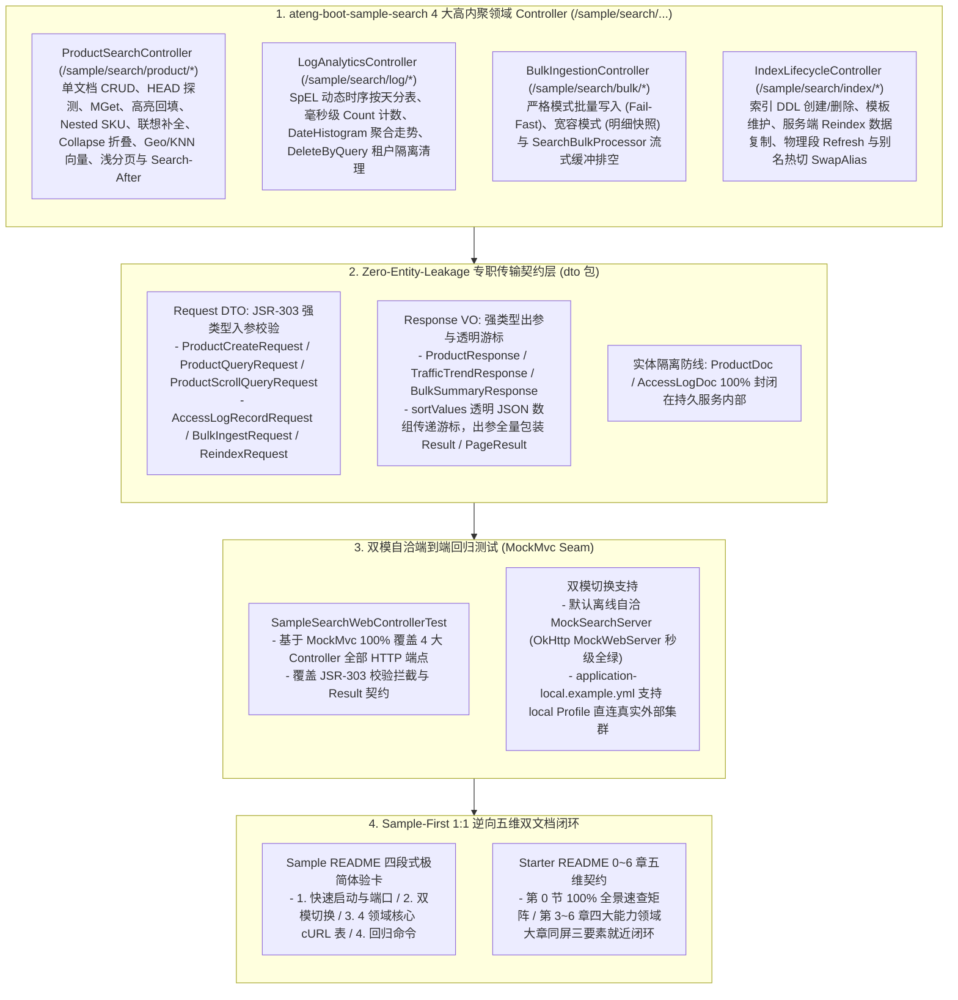

# 106. 全文检索样例工程多控制器领域解耦、Web 体验化与五维规范重构架构决策 (Search Sample Multi-Controller Domain Decoupling, Web Experience & 5D Documentation Architecture)

## 状态
已采纳 (Accepted)

---

## 背景与痛点

在 [ADR-0053](./0053-enterprise-dual-engine-search-and-analytics-architecture.md) 与 [ADR-0084](./0084-search-full-scenario-hardening-and-resilient-analytics-architecture.md) 中，框架确立了 `ateng-boot-search` 基于 Elasticsearch 8.x 官方原生 Java 客户端构建的高性能检索底座，完整落地了 `SearchTemplate` 对称门面、OCC 乐观并发控制、双模 Bulk 写入、受管非阻塞 `SearchBulkProcessor`、浅分页熔断与 `Search-After` 深度游标分页，以及轻量 HEAD 探测（`existsById`）、轻量计数（`count`）、批量拉取（`getByIds`）、多租户隔离批量清理（`deleteByQuery`）、多字段高亮自动回填（`@HighlightField`）、Nested SKU 嵌套检索、拼写联想补全、Collapse 折叠去重、Geo 空间计算、KNN 密集向量召回、时序直方图（`dateHistogram`）、服务端 `reindex` 与原子别名热切（`swapAlias`）。

然而，对照框架权威规约《工业级文档与样例工程标准规范》（[`docs/agents/documentation-specification.md`](../agents/documentation-specification.md)）与近期落地的标杆模块（如 TCP、MQTT、SnailJob 等）逐项审计后，发现 `ateng-boot-search` 与 `ateng-boot-samples/ateng-boot-sample-search` 在开发者体验闭环、契约一致性与文档规范化层面存在以下结构性断层：

1. **样例工程沿用过时的“零 Controller 伪约束” (Developer Experience Barrier)**：
   - 受早期 [ADR-0084](./0084-search-full-scenario-hardening-and-resilient-analytics-architecture.md) 第 4 节“废除单一单体服务类，将 `ateng-boot-sample-search` 重构为以业务场景命名的独立组件矩阵（零 Controller 污染）”局部约定约束，样例工程缺少 Web 控制面与对外暴露的 HTTP 交互端点；开发者启动工程后无法通过标准 RESTful API 或 cURL 快速体验高亮检索、Nested 匹配、Collapse 折叠、KNN 向量、Search-After 深分页、时序聚合、严格/宽容批量及零停机别名热切，严重违背全框架现行“多控制器领域交互体验”红线规范。
2. **缺乏专职传输模型，存在持久层实体泄露隐患 (Entity Leakage Hazard)**：
   - 当前样例服务直接使用带有 `@SearchIndex` / `@SearchId` 注解的持久层索引实体（`ProductDoc` 与 `AccessLogDoc`）作为方法签名载荷，缺少专职的 Request DTO 与 Response VO 分层，未挂载 JSR-303 前置校验，违背了框架核心规约中的 **Zero-Entity-Leakage（传输契约与持久层绝对解耦）** 红线。
3. **自动化测试边界未触达 Web 接入层 (Missing Web Seam Verification)**：
   - 现有的 `SampleSearchIntegrationTest` 虽基于内存自洽的 MockWebServer 实现了离线测试，但测试仅停留在 `@Service` 组件方法调用层，未能覆盖真实 Web 运行时下的 HTTP 路由分发、请求参数绑定、JSR-303 异常拦截转译以及 `Result<T>` 序列化契约。
4. **Starter 与 Sample 文档结构脱节于五维规范 (5D Specification Gap)**：
   - 样例工程文档 `README.md` 仅包含 23 行简短说明，未遵循标准的“四段式极简体验卡”模板（缺少快速启动端口、双模切换指引及可一键复制的 cURL 体验矩阵）；Starter `ateng-boot-search/README.md` 中的示例代码未严格按能力领域大章收敛，部分代码未 100% 逆向提取自已跑通的 Sample 业务端点，小节三要素（专属 YAML + 真实 Java + 机制边界）就近闭环不够彻底。
5. **架构决策记录存在历史滞后冲突 (Architecture Decision Drift)**：
   - `ADR-0084` 保留的“零 Controller 不变量”与当前全库统一推行的《工业级文档与样例工程标准规范》产生直接冲突，亟需确立全新的架构决策记录以明晰演进路径与历史更迭。

---

## 核心决策与架构内容

秉承纯原生、零臃肿依赖与 Zero-Entity-Leakage 传输契约原则，正式确立 **全文检索底座样例工程多控制器领域解耦、Web 体验化与五维规范重构架构**：

### 1. 废止零 Controller 局部约定，落地 4 大专职 Controller（Zero-Entity-Leakage）
- 显式取代 [ADR-0084](./0084-search-full-scenario-hardening-and-resilient-analytics-architecture.md) 第 4 节“以业务场景命名的独立组件矩阵（零 Controller 污染）”局部约定（对齐全域 [文档与样例工程标准规范](../agents/documentation-specification.md) 与 [ADR-0099](./0099-mqtt-sample-web-experience-and-documentation-specification-architecture.md) 先例），在 `ateng-boot-sample-search/pom.xml` 引入 `ateng-boot-web`；
- 按业务领域职责拆分为 4 大高内聚 `@RestController`（统一 `/sample/search/<domain>/<action>` 路由，严格采用 JSR-303 Request DTO 入参与强类型 `Result<T>` + 业务 VO 出参，100% 阻断 `ProductDoc` 与 `AccessLogDoc` 直接泄露至 HTTP 边界）：
  1. **`ProductSearchController`（路由 `/sample/search/product/*`）**：负责商品 CRUD、HEAD 轻量探测（`exists`）、`_mget` 批量拉取、多字段高亮、Nested 嵌套 SKU 匹配、前缀即时补全（`suggest`）、Collapse 折叠去重、Geo 距离筛选、KNN 稠密向量召回、浅分页与基于透明游标数组的 Search-After 游标深度分页；
  2. **`LogAnalyticsController`（路由 `/sample/search/log/*`）**：负责 SpEL 动态时序按天分表写入、`_count` 路径计数、DateHistogram 直方图时间分桶聚合走势统计、DeleteByQuery 多租户隔离批量清理；
  3. **`BulkIngestionController`（路由 `/sample/search/bulk/*`）**：负责严格事务性批量写入（Fail-Fast）、宽容容错批量写入（返回明细快照）与 `SearchBulkProcessor` 异步缓冲流式投递与手动触发排空；
  4. **`IndexLifecycleController`（路由 `/sample/search/index/*`）**：负责索引 DDL 结构创建/删除、时序/组件索引模板维护、服务端平滑重索引（`reindex`）、物理 Lucene 段刷新（`refresh`）与原子别名热切换（`swapAlias`）。

### 2. 构建严格的 DTO/VO 传输契约与游标规范
- **传输层与持久层绝对解耦**：在 `ateng-boot-sample-search` 下创建专职 `dto` 包，包含 `ProductCreateRequest`、`ProductUpdateRequest`、`ProductQueryRequest`、`ProductScrollQueryRequest`、`AccessLogRecordRequest`、`BulkIngestRequest`、`ReindexRequest`、`IndexCreateRequest` 与 `ProductResponse`、`TrafficTrendResponse`、`BulkSummaryResponse` 等，出参统一包装标准 `Result<T>` 或 `PageResult<T>`；
- **Search-After 深度游标透明传递**：在 Web 交互层，深分页游标统一使用透明 JSON 数组（`List<Object> sortValues`）承载排序凭据，拒绝 Base64 编解码所引入的不必要技术债与调试负担；
- **请求谓词与传参规范**：复合布尔检索、Nested SKU 检索、Geo 空间检索、KNN 向量检索等复杂查询统一采用 `POST + @RequestBody @Valid DTO`，轻量探测与联想采用 `GET` 谓词；
- **多租户上下文无侵入透传**：多租户场景依托标准 `X-Tenant-Id` HTTP 请求头透传，业务层通过 `TenantContextHolder` 自动挂载，触发 `ateng-boot-search` 的行级租户安全过滤网。

### 3. 端到端自动化回归测试 (MockMvc Seam)
- 编写 `SampleSearchWebControllerTest`，以 Spring `MockMvc` 为最高接入切入点，100% 覆盖 4 大 Controller 的全部 HTTP 端点，全真断言路由映射、参数校验失败拦截（Fail-Fast）与业务响应字段；
- 底层依靠内存自洽的 OkHttp MockWebServer（`MockSearchServerInitializer`）接管，实现离线自洽构建秒级全绿通过；同时保留 `application-local.example.yml` 大写占位符模板支持直连外部真实 Elasticsearch 集群。

### 4. Sample-First 1:1 逆向五维文档闭环
- **Sample 四段式极简体验卡**：重构 `ateng-boot-sample-search/README.md`，提供快速启动方式、默认/local 双模切换说明、精选 12~14 个核心高频场景的 cURL 体验矩阵，以及全真自动化回归命令；
- **Starter 五维文档重构**：依据实测全绿的 Sample 业务源码，1:1 逆向重构 `ateng-boot-search/README.md`：
  - 第 0 节：100% 收录模块对外暴露的公共门面、注解、配置项与 SPI，杜绝死代码；
  - 第 3~6 章：按 4 大业务能力大章收敛，小节严格同屏闭环专属 YAML 片段、真实 Java 示例代码与底层机制边界说明；
  - 逐项对照《12 项成熟度与文档双向对齐自检清单》准出。

---

## 后果与权衡 (Consequences)

### 正向收益
1. **开发者体验显著提升**：由以往枯燥的纯后台场景组件转变为可通过 HTTP / cURL 交互的丰富 Web 体验卡，极大降低了开发者的学习与上手门槛；
2. **架构安全网与规约对齐**：消除了实体直接暴露隐患，严格落实了 Zero-Entity-Leakage 传输边界原则；
3. **测试覆盖深度推进**：测试 Seam 由内部 Service 调用提升至外部 HTTP 接入层，保证了对外暴露 REST 契约的真实可靠性；
4. **架构决策连贯可溯**：系统性理清了由 [ADR-0084](./0084-search-full-scenario-hardening-and-resilient-analytics-architecture.md) 早期局限向现代统一规范的演进脉络，确保架构文档的自洽一致。

### 妥协与边界
- 样例工程引入 `ateng-boot-web` 仅限于标注了 `<maven.deploy.skip>true</maven.deploy.skip>` 的非分发样例工程内部，`ateng-boot-search` Starter 本身依然保持 100% 纯净原生依赖，无任何非必要的 Web 传输层耦合。
