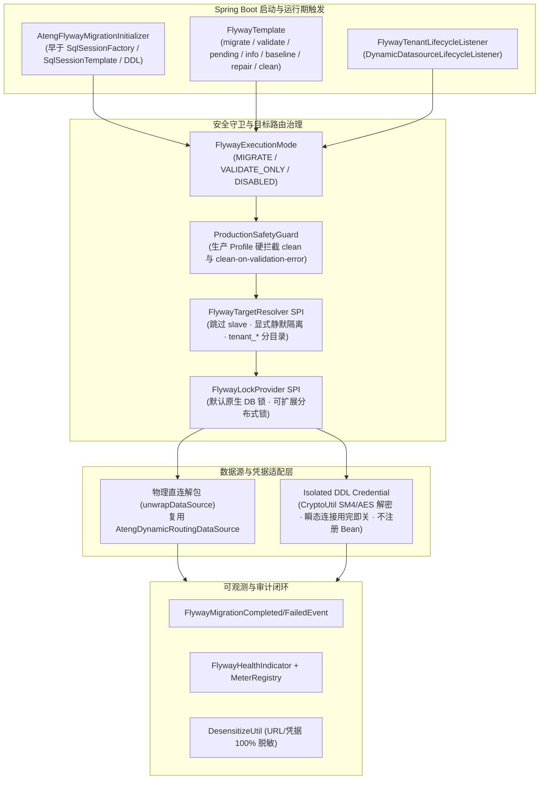

# ADR-0107: Flyway 数据库版本化迁移与多数据源协同架构决策

- **状态**：`Accepted`
- **日期**：2026-11-17
- **作者**：Ateng
- **归属模块**：`ateng-boot-flyway` / `ateng-boot-datasource` / `ateng-boot-mybatis-plus` / `ateng-boot-observability` / `samples`
- **相关决策**：
  - [ADR-0003: 基于 BOM Import 机制的无侵入依赖统管](./0003-dependency-management-via-bom-import.md)
  - [ADR-0006: 技术依赖基线锁定与安全升级策略](./0006-dependency-baseline-and-upgrade-strategy.md)
  - [ADR-0025: Core 核心底座全方位扩建与未来中间件孵化地基架构决策](./0025-core-module-expansion-and-future-proof-middleware-foundations.md)
  - [ADR-0049: 动态多数据源与物理多租户隔离架构决策](./0049-dynamic-datasource-and-physical-multi-tenancy-architecture.md)
  - [ADR-0078: 动态数据源全场景加固与自愈治理架构决策](./0078-dynamic-datasource-full-scenario-hardening-and-resilient-governance-architecture.md)

---

## 1. 背景与业务痛点

下游业务工程需要版本化的数据库 Schema 迁移与初始化数据治理能力。尽管 Spring Boot `3.3.13` 原生已自带 `FlywayAutoConfiguration` 并通过 `spring-boot-dependencies` 纳管 `org.flywaydb:*:10.10.0`（且 `cleanDisabled` 默认已为 `true`），但在 `ateng-boot` 企业级生态下直接使用原生 Flyway 仍面临四类真实架构痛点：

1. **与 `ateng-boot-datasource` 的容器级装配冲突与路由隐患**：`AtengDatasourceAutoConfiguration` 采用 `@ConditionalOnMissingBean(DataSource.class)` 装配 `AtengDynamicRoutingDataSource`。若业务工程按原生方式注册 `@FlywayDataSource DataSource` Bean（用于独立高权限 DDL 账号迁移），会导致动态路由数据源跳过装配，并干扰多数据源健康探针与守卫探测；同时，原生 Flyway 无法直接识别主从读写分离拓扑与多租户物理分库。
2. **多业务库与 SaaS 物理租户生命周期迁移空白**：`ateng-boot-datasource` 预留了 `DynamicDatasourceLifecycleListener`（动态挂载租户库时触发 DDL 迁移），但缺乏开箱即用的多目标库脚本路由、动态挂载自动建表及批处理容错聚合机制。
3. **Flyway 10.x 模块化拆包与安全守卫缺口**：Flyway 10 将各数据库方言拆分为独立包（`flyway-mysql`、`flyway-database-postgresql` 等）；且原生缺少针对生产 Profile 的 `clean` 与 `clean-on-validation-error` 物理硬熔断、隔离式加密 DDL 凭据、只校验不改表门禁（`VALIDATE_ONLY`）、对称编程式门面 `FlywayTemplate` 与统一因果异常体系。
4. **MyBatis-Plus 启动初始化顺序屏障不足**：MyBatis-Plus `3.5.17` 自带的 `MybatisDependsOnDatabaseInitializationDetector` 仅覆盖 `SqlSessionTemplate`，对直接注入 `SqlSessionFactory`、外部动态 SQL 预热及 `DdlApplicationRunner` 等场景需要显式强化依赖顺序。

---

## 2. 核心架构设计与决策内容

### 2.1 独立正交 Starter 定位（不入 `ateng-boot-all`）
- 新建独立模块 **`ateng-boot-flyway`**（配套 `ateng-boot-sample-flyway`），遵循按需独立引入原则，不纳入 `ateng-boot-all` 的 `CoreStarterBundle`；
- 仅强依赖 `ateng-boot-core`、`org.flywaydb:flyway-core`（含 H2）与基础 JDBC 支持，**不强绑** `ateng-boot-datasource` 或 `ateng-boot-mybatis-plus`，保证单库与纯 JDBC/JPA 工程零多余依赖；
- 通过 `@ConditionalOnClass` 弱依赖探测，按需激活与 `ateng-boot-datasource`、`ateng-boot-mybatis-plus` 及可观测组件的协同适配。

### 2.2 三级多数据源迁移模型与三轨防串库路由
- **L1（主从读写分离锁主库）**：在动态路由数据源环境下通过 `unwrapDataSource` 解包底层物理主库执行迁移，强制跳过 `slave`、`*_slave` 与只读 `GroupDataSource`；
- **L2（静态多业务库独立迁移）**：`master` 主库沿用 `spring.flyway.locations`（默认 `classpath:db/migration`）；额外独立业务库仅当在 `ateng.boot.flyway.datasources.<dsKey>` 显式配置时才纳管迁移（缺省回退 `classpath:db/migration/<dsKey>`），未配置的第三方/辅助库默认不侵入；
- **L3（SaaS 物理多租户全生命周期）**：开启租户迁移后匹配 `tenant_` 前缀（兼容 `tenant_<id>_master` 及 `TenantDataSourceProvider` 映射）与动态挂载新租户库，默认使用与主库物理隔离的专用目录 `classpath:db/migration/tenant`，避免平台表与租户业务表相互串库；
- 提供 `FlywayTargetResolver` SPI 支持自定义目标发现与脚本映射规则；单目标块支持按需覆写 `enabled`、`locations`、`table`、`schemas`、`default-schema`、`baseline-on-migrate`、`baseline-version`、`validate-on-migrate`、`out-of-order`、`encoding` 与 `placeholders`（未配置项透明继承 `spring.flyway.*`），并默认自动注入不覆盖显式声明的只读上下文占位符 `ateng_ds_key` 与 `ateng_tenant_id`。

### 2.3 容错、受管并发、动态挂载回滚与集群锁
- **分层失败策略（对齐 `BatchExecutionPolicy`）**：主库与显式配置的核心静态库固定采用 **`FAIL_FAST`**（失败即阻断启动）；SaaS 多租户批量迁移默认采用 **`FAIL_SAFE`**（对齐 `DynamicDatasourceTemplate.forEachTenant` 语义，单租户异常汇总至 `BatchMigrationResult` 并发布失败事件，不拖垮整体服务，且支持配置切换为 `FAIL_FAST`）；
- **动态挂载失败处置策略（`DynamicMountFailurePolicy`）**：由于 `DynamicDatasourceTemplate.notifyDataSourceAdded` 内部捕获监听器异常且在同一线程持有 `lifecycleLock`（`ReentrantLock` 可重入），维持 `ateng-boot-datasource` 零改动，在监听器内提供 **`KEEP_AND_REPORT`**（默认：保留数据源并发布失败事件以便重试补迁）与 **`ROLLBACK_DATASOURCE`**（同线程主动调用 `DynamicDatasourceTemplate.removeDataSource(dsKey, true)` 摘除未建表数据源，防流量误入）；
- **受管并发执行**：多租户批量迁移默认串行（`concurrency = 1`），支持配置有界并发（`> 1`）并依托 `ateng-boot-core` 受管线程池与 `AsyncContext` 透传上下文，支持启动同步（默认）与大租户群可选异步；
- **集群并发迁移锁**：默认依托 Flyway 原生数据库表级/咨询锁保证 K8s 多副本并发启动安全，不强绑 Redis；同时预留可选的 `FlywayLockProvider` SPI。

### 2.4 配置模型边界与方言版本基线
- 保留 Spring Boot 原生 `spring.flyway.*` 作为内核参数真源，`ateng.boot.flyway.*` 专职收敛企业级增强治理；
- 直接复用 `ateng-boot-bom` 通过 `spring-boot-dependencies:3.3.13` 统管的 `org.flywaydb:*:10.10.0` 基线；官方方言驱动（`flyway-mysql`、`flyway-database-postgresql`、`flyway-database-oracle`、`flyway-sqlserver`）在 Starter 中设为 `<optional>true</optional>` 按需声明，非内置国产库预留 `FlywayConfigurationCustomizer` SPI 逃生舱。

### 2.5 原生装配接管、生产安全防线与隔离式 DDL 凭据
- **原生 `FlywayAutoConfiguration` 统一接管**：`AtengFlywayAutoConfiguration` 声明 `@AutoConfigureBefore(FlywayAutoConfiguration.class)`，当 `ateng.boot.flyway.enabled=true` 时接管启动迁移入口（彻底杜绝原生自动装配重复迁移或绕过守卫），同时 100% 自动透传 Spring 容器中的 `FlywayConfigurationCustomizer`、`JavaMigration` 与 `Callback` Bean 及原生 `{vendor}` 路径机制；当 `enabled=false` 时完全退让给原生装配；
- **双重生产安全硬熔断（`ProductionSafetyGuard`）**：在受保护生产 Profile（默认 `prod`/`production`/`prd`，可配）下，强制物理拦截 `clean` 调用，并**强制熔断 `clean-on-validation-error = true`**；保持默认 `baseline-on-migrate = false`、`validate-on-migrate = true`、`out-of-order = false`；
- **三态运行模式（`FlywayExecutionMode`）**：支持 **`MIGRATE`**（默认自动迁移）、**`VALIDATE_ONLY`**（仅校验版本与 Checksum 一致性，严禁变更表结构）与 **`DISABLED`**（跳过自动迁移）；
- **隔离式 DDL 凭据与闭池安全**：保持 `AtengDatasourceAutoConfiguration` 的 `@ConditionalOnMissingBean(DataSource.class)` 语义不变；独立 DDL 账号通过 `ateng.boot.flyway.*` 凭据配置构造瞬态连接（支持 `CryptoUtil` SM4/AES 密文瞬态解密并在迁移后确定性关闭），**严禁向容器注册额外 `@Bean DataSource`**，且不向容器暴露持有已关闭瞬态连接池的 `Flyway` Bean（避免 Actuator `/actuator/flyway` 探查报错）。

### 2.6 对称门面、时序屏障、状态码、可观测与 Sample 矩阵
- **编程式门面与 VO 隔离**：`FlywayTemplate` 对称提供单目标（`migrate`、`validate`、`pending`、`info`、`baseline`、`repair`、受守卫 `clean`）与多目标批量方法（`migrateTargets`、`validateTargets`、`migrateAllTenants`、`validateAllTenants`、`infoAll`）及 `getLastMigrationSummary()`；历史记录查询统一经由 Flyway 原生 API 封装为强类型 VO 返回，不经过 MyBatis-Plus Mapper 访问 `flyway_schema_history`；
- **持久层初始化顺序屏障**：启动期强制早于 MyBatis-Plus `SqlSessionFactory`、`SqlSessionTemplate`、`DynamicSqlRegistry` 与 `DdlApplicationRunner`；
- **状态码与观测**：`FlywayResultCode` 分配至 **`62001 ~ 62020`** 号段；日志/异常/事件对 JDBC URL 与凭据经 `DesensitizeUtil` 脱敏；发布 `FlywayMigrationCompletedEvent` / `FlywayMigrationFailedEvent` 及 `FlywayMigrationListener` SPI；提供缓存感知的 `FlywayHealthIndicator`（`@ConditionalOnClass(HealthIndicator.class)`）与 Micrometer 度量指标；
- **1:1 Sample 矩阵（`ateng-boot-sample-flyway`）**：基于 H2（`MODE=MySQL`）离线模拟 `master` / `slave` / `log_db` / `tenant_1001` / `tenant_1002` + 动态挂载 `tenant_1003` 全拓扑，引入 `ateng-boot-web` 拆分为 `FlywayMigrationController`、`FlywayTenantController` 与 `FlywayGovernanceController` 三个领域 Controller 并完成双模测试闭环。

---

## 3. 后果与权衡 (Consequences & Trade-offs)

1. **正交独立引入 vs 全家桶打包**：不加入 `ateng-boot-all` 可保持无数据库项目及极简单体依赖纯净，但需要 Flyway 能力的工程需显式引入 `ateng-boot-flyway` 及对应的数据库方言包（如 `flyway-mysql`）。
2. **复用 `spring.flyway.*` vs 全量镜像配置**：避免了 50+ 原生属性重复维护与生态割裂，要求开发者在配置内核行为时沿用 `spring.flyway.*`、在配置多源/守卫/租户治理时使用 `ateng.boot.flyway.*`。
3. **非 Bean 瞬态 DDL 连接 vs `@FlywayDataSource` Bean**：零侵入解决了与 `AtengDatasourceAutoConfiguration` 的 `@ConditionalOnMissingBean(DataSource.class)` 冲突及闭池健康探针误报，代价是需引导用户通过 `ateng.boot.flyway.*` 配置 DDL 独立凭据而非手写 `@FlywayDataSource` Bean。
4. **监听器内部可重入回滚 vs 修改 `ateng-boot-datasource` 源码**：维持既有动态数据源模块零回归风险，且允许按需在“保留故障源重试补迁（默认）”与“摘除半残租户源（严格）”之间平滑切换。
