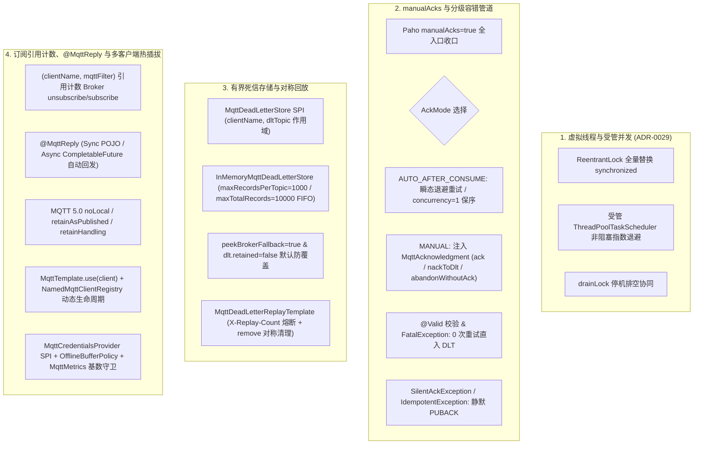

# 108. MQTT 可靠性治理、有界死信存储与虚拟线程合规架构决策 (MQTT Reliability Governance, Dead Letter Store & Virtual-Thread Compliance Architecture)

## 状态
`Accepted`（演进修订并部分取代 [ADR-0047](./0047-mqtt-iot-communication-and-edge-control-architecture.md)、[ADR-0074](./0074-mqtt-full-scenario-hardening-dead-letter-replay-and-connection-governance-architecture.md) 与 [ADR-0099](./0099-mqtt-sample-web-experience-and-documentation-specification-architecture.md) 中的既有局部约定；注：原规划号段 `0107` 已由 Flyway 架构决策占用，本篇顺延分配为 `0108`）

---

## 背景与痛点 (Context & Problem Statement)

在完成 [ADR-0047](./0047-mqtt-iot-communication-and-edge-control-architecture.md)、[ADR-0074](./0074-mqtt-full-scenario-hardening-dead-letter-replay-and-connection-governance-architecture.md) 及 [ADR-0099](./0099-mqtt-sample-web-experience-and-documentation-specification-architecture.md) 后，`ateng-boot-mqtt` 已具备双向收发、RPC、毒丸 DLT、容器启停与 7 控制器 Web 体验能力。但对照生产高并发稳定性、JDK 21+ 虚拟线程规范与工业级九道防线深度体检，存量实现暴露出六大深水区结构性短板：

1. **虚拟线程 Carrier Pinning 与阻塞退避隐患**：核心组件（`NamedMqttClientRegistry`、`MqttRequestReplyManager`、`MqttListenerEndpointRegistry`、`MqttTemplate`、`MqttMetrics`）广泛使用 `synchronized` 同步块，在 JDK 21+ 虚拟线程执行重连、订阅或发布 I/O 临界区时会触发 Carrier Thread Pinning；同时消费异常后若同步阻塞等待或直接依赖 Broker 粗暴重推，极易耗尽回调工作线程。
2. **ACK 自动确认竞态、瞬态异常无缓冲重放与 `@Valid` 死循环**：Paho 默认自动确认模式会在异步调度尚未真正成功前过早向 Broker 返回 PUBACK/PUBCOMP（节点崩溃丢消息）；同时缺乏受管指数退避重试机制（及单分区 `concurrency = 1` 顺序防插队保障），遇到暂时性外部 DB/RPC 抖动即直接失败；而业务层希望细粒度控制确认时机时缺乏 `AckMode.MANUAL` + `MqttAcknowledgment` 句柄；此外消费端方法入参标注 JSR-303 `@Valid` 校验失败属于不可自愈毒丸，若参与重试将白白浪费调度配额。
3. **死信存储依赖 Broker `retained=true` 导致后发覆盖前发**：原 `dead-letter` 转移默认将 DLT 报文作为 Retained 消息发布到 `${topic}/DLT`，导致 MQTT Broker 仅能保留**最后 1 条**毒丸报文，连续出现多条毒丸时历史死信被静默覆盖销毁，无法完整排查或批量重放。
4. **“伪暂停”丢消息、引用计数退订缺失与声明式 `@MqttReply` 缺位**：原 `MqttContainerManager.pause()` 若仅在内存标记暂停而未控制物理订阅，Broker 仍会持续推流造成积压或误丢；而同主题共享过滤器的多监听器若单方面直接向 Broker 退订又会误杀同连接其他活跃端点；同时服务端处理 `@MqttListener` RPC 请求仍需手工读取 `ResponseTopic`/`CorrelationData` 并调用 `MqttAsyncClient` 回发，样板代码冗余且未开放 MQTT 5.0 `noLocal`、`retainAsPublished`、`retainHandling` 订阅选项。
5. **高基数指标 OOM 风险、断线离线缓冲策略僵化与动态客户端治理不完备**：默认将物理动态主题（含百万级设备 ID）打入 Prometheus `topic` Tag 会引发时序库基数爆炸与进程 OOM；断线重连窗期内普通发布缺乏 `FAIL_FAST` 选择；运行期缺乏 `MqttTemplate.use(clientName)` 不可变绑定视图、`NamedMqttClientRegistry` 动态注册/热替换/对称注销闭环、`MqttCredentialsProvider` 云厂商动态令牌刷新、`serverUris` HA 地址组与 `webSocketHeaders` / `willDelayInterval` / `clientKeyPassword` / `hostnameVerificationEnabled` 支持。
6. **文档漂移与历史类/标头名失实**：`ateng-boot-mqtt/README.md` 长期存在幽灵类名（`MqttPayloadGuard` 实际为 `PayloadGuard`）、错配的死信重放标头（`x-dlt-replay-count` 实际为 `X-Replay-Count`）及失真的 SPI 方法签名示例，亟需以 Sample-First 原则基于 8 大实测 Controller 1:1 逆向纠偏。

---

## 决策内容与落地设计 (Decision & Architecture)

### 1. P0 虚拟线程合规与非阻塞受管重试调度
- **锁原语彻底升级**：全模块将涉及 I/O、注册表变更、订阅操作与指标绑定的 `synchronized` 全面替换为 `ReentrantLock`，彻底杜绝 JDK 21+ 虚拟线程 Carrier Pinning；
- **非阻塞退避与保序**：取消消费线程阻塞等待，基于 Spring 受管 `ThreadPoolTaskScheduler` 执行可恢复瞬态异常的指数退避重试（`initialBackoff=200ms`，`backoffMultiplier=2.0`，`maxBackoff=5s`，`maxRetries=2`）；当端点声明 `concurrency = 1` 时采用单分区顺序队列执行重试调度，严格防止同设备乱序反转；停机时经由 `drainLock` 等待在途消费排空；
- **零野线程底线**：全模块零 `new Thread()` 与 `Executors` 裸池调用，统一归口 Core 受管线程池与调度器。

### 2. 全量 `manualAcks = true`、`AckMode` 与零重试毒丸铁律
- **底层确认收口**：`NamedMqttClientRegistry` 构建所有 `MqttAsyncClient` 时强制设置 `manualAcks = true`，由框架通过 `MqttClientHandle.messageArrivedComplete(...)` 统一对 QoS 1/2 提交 PUBACK/PUBCOMP（QoS 0 自动跳过）；
- **双模消费确认**：`AtengMqttProperties.consumer.ackMode` 与 `@MqttListener(ackMode = ...)` 支持 `AUTO_AFTER_CONSUME`（默认）与 `MANUAL`。`MANUAL` 模式下向监听方法注入严格单次幂等状态机句柄 `MqttAcknowledgment`（`ack()`、`nackToDlt()`、`abandonWithoutAck()`、`isAcknowledged()`），首次状态跃迁生效后后续调用均为幂等空操作；
- **分类快速分流**：消费端 JSR-303 `@Valid` 校验失败（`ConstraintViolationException` / `MethodValidationException`）与 `FatalExceptionClassifier` 判定的致命异常执行 **0 次重试直接路由至 DLT**；`SilentAckException` 与 `IdempotentException` 直接触发静默 PUBACK，彻底终结死循环。

### 3. `MqttDeadLetterStore` SPI 与对称清理闭环（修订 [ADR-0074](./0074-mqtt-full-scenario-hardening-dead-letter-replay-and-connection-governance-architecture.md)）
- **解除 Broker Retained 单条覆写瓶颈**：新增 `MqttDltProperties`（前缀 `ateng.boot.mqtt.dlt`），将 `dlt.retained` 默认设为 **`false`**，新增 `MqttDeadLetterStore` SPI 并在无外部实现时自动装配有界内存实现 `InMemoryMqttDeadLetterStore`；
- **作用域隔离与双维有界淘汰**：按 `(clientName, dltTopic)` 逻辑作用域保存连续毒丸记录序列，配置单主题上限（`maxRecordsPerTopic=1000`）与全局上限（`maxTotalRecords=10000`）FIFO 双索引淘汰防 OOM，内部采用 `ReentrantLock` 保证虚拟线程安全；
- **兼容性与精确删除**：开启 `peekBrokerFallback=true`（默认）时兼容回退拉取历史遗留 Retained 死信；重放成功单条调用 `remove(clientName, dltTopic, recordId)`，清空时 `purge(clientName, dltTopic)` 同步清理 Store 与 Broker Retained 残留，重放标头严格统一为 `X-Dead-Letter-Replayed`、`X-Replay-Count`、`X-Replay-Timestamp`。

### 4. `@MqttReply` 声明式应答、MQTT 5.0 订阅选项与引用计数暂停
- **声明式双向应答**：新增 `@MqttReply(topic, qos, retained)` 注解作用于 `@MqttListener` 方法，支持同步 POJO 返回与异步 `CompletableFuture<T>` 返回；当未硬编码 `topic` 时自动解析入站 MQTT 5.0 `ResponseTopic` 与 `CorrelationData` 原路安全回发应答报文；
- **MQTT 5.0 原生订阅语义**：`@MqttListener` 原生暴露 `noLocal`（防同连接自发回环）、`retainAsPublished` 与 `retainHandling`（`0/1/2`）参数并通过 `MqttSubscription` 下发；
- **引用计数驱动物理退订/恢复**：`MqttContainerManager` 与 `MqttListenerEndpointRegistry` 以 `(clientName, mqttFilter)` 为维度维护活跃端点引用计数——仅当同过滤器最后一个端点 `pause` 时才向 Broker 下发真实 `unsubscribe`，`resume` 首个端点时幂等重建 `subscribe`，彻底解决伪暂停丢包与共享过滤器误退订问题。

### 5. 多客户端热插拔、动态凭据、离线策略与指标基数防线
- **客户端绑定视图与动态生命周期**：`MqttTemplate.use(clientName)` 返回共享核心编解码/拦截器与绑定锁的轻量不可变客户端绑定视图（优先级高于 `MqttContextHolder`）；`NamedMqttClientRegistry` 提供运行时 `registerClient`、`registerOrReplaceClient` 与 `unregisterClient(clientName, force)` 联动解除动态订阅与注销指标 Gauge；
- **动态凭据与连接能力扩展**：新增 `MqttCredentialsProvider` SPI（与不可变快照 `MqttCredentials`）支持初次建连及断线重连动态刷新 `username`/`password`/MQTT 5.0 增强认证字段；新增 `OfflineBufferPolicy`（`BUFFER_WHEN_RECONNECTING` / `FAIL_FAST`）；补全多节点 HA `serverUris`、`webSocketHeaders`、`lwt.willDelayInterval`、`ssl.clientKeyPassword` 与 `ssl.hostnameVerificationEnabled`（生产默认开启主机名核验）；
- **低基数 Micrometer 防爆默认**：新增 `MqttMetricsProperties`（`ateng.boot.mqtt.metrics.*`），默认 `includeTopicTag = false` 将物理主题从 Prometheus Tag 剥离以避免设备规模增长导致 OOM；显式开启时强制受 `maxTopicCardinality = 200` 上限与 `__overflow__` 溢流兜底保护；消费者延迟/死信度量使用声明式主题模板（如 `iot/devices/{deviceId}/telemetry`）。

### 6. Sample 8 控制器闭环与五维文档纠偏不变量（演进 [ADR-0099](./0099-mqtt-sample-web-experience-and-documentation-specification-architecture.md)）
- 在原 7 大 `@RestController` 基础上新增第 8 个领域控制器 `MqttClientGovernanceController`（`/sample/mqtt/clients/*`）与 `ClientGovernanceScenarioService`，并补齐 `@MqttReply`、`@Valid` 0 次重试转死信、`MqttDeadLetterStore` 多条毒丸保留、`AckMode.MANUAL`、`concurrency=1` 退避重试及 `noLocal`/`retainHandling` 验证，构成 **8 大 Controller / 30 个 REST 端点 / 双模 36 项测试用例**（`SampleMqttWebControllerTest` 26 项 + `SampleMqttE2eTest` 10 项，离线内存桩与真实 Broker `local` 模式 100% 全绿）；
- Starter `README.md` 严格依据上述实测 Sample 1:1 逆向重写，彻底清除 `MqttPayloadGuard`、`x-dlt-replay-count` 与过期 SPI 签名漂移。

---

## 后果与权衡（正向收益与妥协成本）

### 正向收益
1. **高并发与虚拟线程就绪**：全链路 `ReentrantLock` 与非阻塞调度消除了 JDK 21+ 虚拟线程 Carrier Pinning 与 Paho 回调阻塞风险。
2. **语义完备与零消息丢失**：`manualAcks = true`、`AckMode.MANUAL`、`concurrency=1` 保序重试、有界 `MqttDeadLetterStore` 与引用计数物理 pause/resume 使 MQTT 底座真正对齐 Kafka/RabbitMQ 同级工业可靠性契约。
3. **云原生监控与安全稳固**：默认低基数指标保护时序监控安全，mTLS 主机名核验默认开启，动态凭据支持云物联网短期签名无感轮换。

### 妥协与约束成本
1. **默认 Memory DLT 存储跨进程非共享**：内置 `InMemoryMqttDeadLetterStore` 仅在单机进程内留存，进程重启会丢失内存死信；分布式多副本长期滞留检索需由业务方实现 `MqttDeadLetterStore`（如对接 Redis / DB）覆盖装配。
2. **默认屏蔽物理 `topic` 度量标签**：为保障开箱防 OOM，`mqtt.message.published` 等指标默认不再细分具体物理主题标签；确需按主题分维度排查时需显式开启 `ateng.boot.mqtt.metrics.include-topic-tag=true` 并合理评估 `max-topic-cardinality`。
