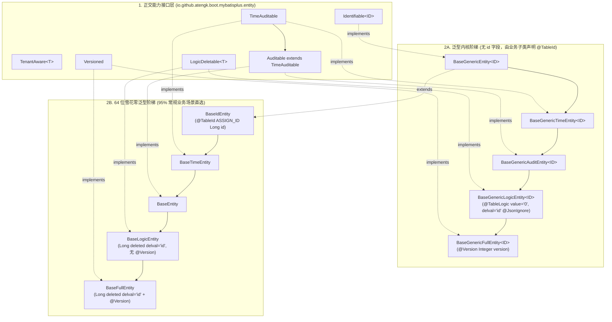

# ADR-0109: 持久层正交能力接口、双轨实体阶梯与统一占位软删架构决策 (MyBatis-Plus Orthogonal Entity Contracts & Dual Entity Ladder Architecture)

- **状态**：`Accepted`（演进替代并净切取代 [ADR-0017](./0017-multi-tenant-row-level-isolation-architecture.md)、[ADR-0033](./0033-mybatis-plus-production-hardening-and-streaming-architecture.md) 与 [ADR-0056](./0056-mybatis-plus-lifecycle-completeness-and-concurrency-architecture.md) 中的旧实体基类、`TenantEntity`、`0/1` 软删双轨与 `version = 1` 初始补偿约定）
- **日期**：2026-11-20
- **作者**：Ateng
- **归属模块**：`ateng-boot-mybatis-plus` / `samples` / `core`
- **关联工单**：Issue #1134
- **相关决策**：
  - [ADR-0017: 企业级行级多租户安全隔离与自动填充架构](./0017-multi-tenant-row-level-isolation-architecture.md)
  - [ADR-0019: 原生高性能分批批量插入引擎架构决策](./0019-native-high-performance-batch-insert-engine.md)
  - [ADR-0033: 持久层生产级加固与流式游标防 OOM 架构决策](./0033-mybatis-plus-production-hardening-and-streaming-architecture.md)
  - [ADR-0034: 动态查询转译、双方言批量增强与数据变更审计架构决策](./0034-dynamic-query-multidialect-upsert-and-data-audit-architecture.md)
  - [ADR-0056: 持久层全生命周期闭环、高阶并发加固与全场景样例实装架构决策](./0056-mybatis-plus-lifecycle-completeness-and-concurrency-architecture.md)

---

## 1. 背景与痛点

`ateng-boot-mybatis-plus` 在早期演进中形成了“五级实体阶梯链 + 第 5B 分支”（`BaseGenericEntity<ID>` -> `BaseIdEntity` -> `BaseTimeEntity` -> `BaseEntity` -> `BaseFullEntity` / `BaseDeleteIdEntity`）及 `TenantEntity` 标记接口。在实际业务与框架设计核查中暴露出四类难以靠局部修补解决的结构性缺陷：

1. **泛型主键在 `BaseTimeEntity` 处死锁于 `Long` 雪花主键**：`BaseTimeEntity` 直接继承 `BaseIdEntity`（固定 `Long id` + `IdType.ASSIGN_ID`），导致采用 `String`、`UUID`、自增或自定义输入主键的 `BaseGenericEntity<ID>` 子类完全无法复用时间审计、操作人审计、逻辑删除与乐观锁基类。
2. **双轨软删模型冗余，且 `@Version` 与软删强绑定**：`BaseFullEntity`（`Integer deleted` `0/1` + `@Version`）与 `BaseDeleteIdEntity`（`Long deleted` `delval = "id"` + `@Version`）并存；传统 `0/1` 软删在 `(code, deleted)` 组合唯一索引下无法支持“删除后同编码重建”，而 `BaseDeleteIdEntity` 命名晦涩且强制绑定 `@Version`，迫使无需 CAS 乐观锁的常规组织、字典、配置表也必须携带并维护 `version` 列。
3. **`TenantEntity` 写死 `String`，不兼容 `BIGINT`（`Long tenantId`）实体**：`DefaultTenantLineHandler` 与 `DefaultMetaObjectHandler` 均支持 `Long` 与 `String` 租户标识，但 `TenantEntity` 接口写死 `String getTenantId()`/`setTenantId(String)`，导致 `Long tenantId` 实体无法接入 `BatchUtil` 无反射快速通道；同时当上下文存在非纯数字租户 ID 试图写入 `Long` 字段时，旧实现静默跳过容易写入 `tenant_id = NULL` 隐性脏数据。
4. **`version` 初始值与数据库常规 DDL 冲突，且 `BatchUtil` 硬编码父类类型**：`BatchUtil.autoHeal` 对 `version` 默认补偿 `1`（常见 DDL 为 `DEFAULT 0`），且大量采用 `instanceof BaseIdEntity`/`BaseFullEntity`/`BaseDeleteIdEntity` 硬编码判断，缺少面向能力接口的统一自愈契约。
5. **MyBatis-Plus `3.5.17` 原生逻辑删除对字符型 `delval = "id"` 的底层约束**：经反编译核查 `mybatis-plus-core:3.5.17` 的 `TableFieldInfo.getColumnValue` 与 `TableInfo.formatLogicDeleteSql(false)`，`TableFieldInfo` 虽能通过 `TypeParameterResolver` 将泛型 `BaseGenericLogicEntity<String>` 的 `deleted` 正确解析为 `String.class`（`isCharSequence = true`），但随后 `getColumnValue("id")` 会对其无条件添加单引号，生成 `SET deleted = 'id'`（常量字符串 `'id'`）而非列引用 `SET deleted = id`，致使 `String` 主键实体二次软删仍会触发唯一索引碰撞。

---

## 2. 核心架构设计与决策内容

趁 `ateng-boot` 尚未大规模对外正式投产的窗口期，执行**净切重塑（Clean Cut）**，废除旧 `BaseDeleteIdEntity`、`TenantEntity` 与 `Integer (0/1)` 软删双轨负担，确立以下正交架构体系：

### 2.1 六大纯正交能力接口层
所有接口统一收口于 `io.github.atengk.boot.mybatisplus.entity` 同包下，避免引入子包增加业务导入心智负担：
1. **`Identifiable<ID extends Serializable>`**：声明 `ID getId()` 与 `void setId(ID id)`。
2. **`TenantAware<T extends Serializable>`**：净切取代 `TenantEntity`，声明 `T getTenantId()` 与 `void setTenantId(T tenantId)`，统一兼容 `Long` 与 `String` 租户标识。
3. **`TimeAuditable`**：声明 `LocalDateTime getCreateTime()` / `setCreateTime(...)` 与 `LocalDateTime getUpdateTime()` / `setUpdateTime(...)`，供轻量级只记录时间流转的实体直接接入。
4. **`Auditable extends TimeAuditable`**：继承时间审计并在其上追加 `String getCreateBy()` / `setCreateBy(...)` 与 `String getUpdateBy()` / `setUpdateBy(...)`（保留 `String` 以同时兼容用户名、ID 串与 `"SYSTEM"` 兜底值）。
5. **`LogicDeletable<T extends Serializable>`**：声明 `T getDeleted()` 与 `void setDeleted(T deleted)`。
6. **`Versioned`**：声明 `Integer getVersion()` 与 `void setVersion(Integer version)`。

### 2.2 平行双实体阶梯拓扑（保留单继承语义与主键策略自由度）
由于 Java 仅支持单继承且不同自定义主键策略需将 `@TableId(type = ...)` 标注在具体实体字段上（避免父类字段遮蔽或锁定 `IdType.ASSIGN_ID`），明确采用**两条平行实现正交接口的继承阶梯**，框架内部均面向正交能力接口协作：

1. **泛型内核阶梯**（全链不声明 `id` 字段，保留抽象 `getId/setId` 交由最终业务实体定义主键字段与策略）：
   - `BaseGenericEntity<ID extends Serializable>`（实现 `Identifiable<ID>`）
   - `BaseGenericTimeEntity<ID extends Serializable>`（继承前者，实现 `TimeAuditable`，追加 `createTime`、`updateTime`）
   - `BaseGenericAuditEntity<ID extends Serializable>`（继承前者，实现 `Auditable`，追加 `createBy`、`updateBy`）
   - `BaseGenericLogicEntity<ID extends Serializable>`（继承前者，实现 `LogicDeletable<ID>`，追加 `@TableLogic(value = "0", delval = "id") @JsonIgnore private ID deleted`，**不含 `@Version`**）
   - `BaseGenericFullEntity<ID extends Serializable>`（继承前者，实现 `Versioned`，对称补齐 `@Version private Integer version`）
2. **常用 64 位雪花零泛型阶梯**（保持 `BaseIdEntity` 作为所有雪花实体根父类的连续继承链）：
   - `BaseIdEntity`（继承 `BaseGenericEntity<Long>`，声明 `@TableId(type = IdType.ASSIGN_ID) private Long id`）
   - `BaseTimeEntity`（继承 `BaseIdEntity`，实现 `TimeAuditable`，追加 `createTime`、`updateTime`）
   - `BaseEntity`（继承 `BaseTimeEntity`，实现 `Auditable`，追加 `createBy`、`updateBy`）
   - **`BaseLogicEntity`**（继承 `BaseEntity`，实现 `LogicDeletable<Long>`，**净切取代原 `BaseDeleteIdEntity`**，声明 `@TableLogic(value = "0", delval = "id") @JsonIgnore private Long deleted`，**不强绑 `@Version`**，作为常规软删业务表默认首选）
   - **`BaseFullEntity`**（继承 `BaseLogicEntity`，实现 `Versioned`，统一为 `Long deleted` `delval = "id"` 占位模型并追加 `@Version private Integer version`，专供需要 CAS 乐观锁的高并发状态表）

### 2.3 统一主键占位软删与 `AtengSqlInjector` 字符型修正
- **全面统一占位软删语义**：全框架软删模型统一为未删除 `0`（或 `"0"`）、删除时以自身主键列占位（`SET deleted = <pkColumn>`），在数据库层面与 `(biz_code, deleted)` 等复合唯一索引天然兼容，彻底消除 `0/1` 双轨认知负担。
- **`AtengSqlInjector` 接管原生逻辑删除注入节点**：在 `AtengSqlInjector` 中覆写增强走原生 `sqlLogicSet` 的逻辑删除方法（`DeleteById`、`DeleteByIds`、`Delete`、`DeleteByMap`）：
  - 当 `@TableLogic` 声明的 `delval` 为 `"id"`（或指向实体主键列名）且字段类型为字符型（`isCharSequence == true`）时，打破 MyBatis-Plus 默认 `getColumnValue` 的单引号包裹限制，将其解析并生成**不加引号的真实物理主键列引用** `SET <logicColumn> = <tableInfo.getKeyColumn()>`；
  - `WHERE` 侧继续沿用标准类型字面量（数值型 `deleted = 0`，字符型 `deleted = '0'`），与 `AtengLogicDeleteInnerInterceptor`（仅剥离 `EqualsTo` 且同时识别 `0` 与 `'0'`，保留 `deleted <> 0` 回收站查询条件）及 `AtengServiceImpl.restore*`（基于 `TableFieldInfo.getPropertyType()` 自适应恢复 `0L` / `0` / `"0"`）构成完整闭环。

### 2.4 面向契约的 `BatchUtil` 自愈与 `DefaultMetaObjectHandler` 类型守卫
- **`BatchUtil` 去父类硬编码重构**：
  - `getEntityId` 与 `sortByIdAscending` 对所有 `Identifiable<?>` 走无反射 `getId()` 快速通道，并对非 `Identifiable` 普通实体保留 `@TableId` 反射缓存兜底；
  - `autoHeal` 面向 `Identifiable<?>`（`BaseIdEntity` 直接发雪花 `Long`；其他实现 `Identifiable<?>` 的实体通过元数据缓存检查 `@TableId` 策略，**仅在 `ASSIGN_ID`、`ASSIGN_UUID` 或 `NONE` 时自动回填，严禁强行覆盖 `AUTO` 或 `INPUT` 主键**）、`TimeAuditable`、`Auditable`、`TenantAware<?>`、`LogicDeletable<?>`、`Versioned` 执行无反射快路径自愈；
  - `Versioned` 初始空值统一补偿为 **`0`**（对齐通用数据库 `DEFAULT 0` 约定）；
  - `LogicDeletable<T>` 依托 Spring `GenericTypeResolver` 与字段类型元数据缓存解析真实类型 `T`，按 `Long -> 0L`、`Integer -> 0`、`String -> "0"` 自动补偿。
- **多租户泛型匹配与 Fail-Fast 防线**：
  - `BatchUtil` 与 `DefaultMetaObjectHandler` 均通过接口泛型实参/字段真实类型解析 `TenantAware<T>` 与 `tenantId` 字段；
  - **严格类型防线**：当 `TenantContextHolder.getTenantId()` 存在非空文本但无法解析为 `Long` 却试图注入 `TenantAware<Long>`（或 `Long tenantId`）时，**统一立即 Fail-Fast 抛出明确异常**，彻底杜绝静默跳过导致写入 `tenant_id = NULL` 破坏多租户隔离的隐性事故；
  - `DefaultMetaObjectHandler` 继续保留对无任何接口继承的普通 POJO 实体（按字段名 `MetaObject`）的填充兼容。

---

## 3. 后果与权衡（正向收益与妥协成本）

### 正向收益
1. **任意主键全能力复用**：`String`、`UUID`、自增整型等自定义主键实体通过继承 `BaseGeneric*` 阶梯即可无痛获得时间/操作人审计、主键占位软删防唯一索引冲突与乐观锁能力。
2. **解耦乐观锁与软删、统一防冲突语义**：常规业务/组织/字典表选用 `BaseLogicEntity` 即可享受零唯一键冲突软删且不再被迫维护无意义的 `version` 字段；需要 CAS 并发控制的表则顺滑升阶至 `BaseFullEntity`。
3. **契约面向接口、类型安全防呆**：`TenantAware<T>` 同时纳管 `Long` 与 `String` 租户标识并通过 Fail-Fast 杜绝错类型空租户落盘；`BatchUtil` 与 `DefaultMetaObjectHandler` 消除父类强耦合且对齐 `version DEFAULT 0` 工业惯例。

### 妥协与约束成本
1. **破坏性净切变更（Breaking Clean-Cut）**：移除 `BaseDeleteIdEntity`、`TenantEntity` 与旧 `Integer (0/1)` 软删模型，并将 `BaseFullEntity.deleted` 统一为 `Long` (`delval = "id"`)、`version` 初始补偿从 `1` 改为 `0`；既有的 `sys_user`/`sys_dept` 等基于旧 `BaseFullEntity` 的表 DDL 需将 `deleted` 升级为 `BIGINT DEFAULT 0`（字符型主键表为 `VARCHAR(64) DEFAULT '0'`），回收站仅查已删记录的条件须规范为 `deleted <> 0`（而非 `deleted = 1`）。
2. **双阶梯局部字段重复声明换取单继承直觉与主键自由度**：受限于 Java 单继承机制，`BaseTimeEntity` ~ `BaseFullEntity` 与 `BaseGenericTimeEntity` ~ `BaseGenericFullEntity` 各自声明了 1~2 个对应层级字段；但由于均实现统一正交能力接口，框架引擎与业务扩展点零额外维护成本。
