# ADR-0112: API 传输层混合加解密（@ApiEncrypt / @ApiDecrypt）与 Encrypt-then-Sign 协同架构

- **状态 (Status)**: `Accepted`
- **日期 (Date)**: `2026-11-27`
- **关联模块 (Modules)**: `ateng-boot-web`、`ateng-boot-core`、`ateng-boot-samples/ateng-boot-sample-web`
- **演进溯源 (Extends / Relates to)**: 继承并正交扩展 [ADR-0016](./0016-dual-direction-api-signature-and-anti-replay-engine.md)（`@ApiSign` 双向加验签），严格遵守 [ADR-0002](./0002-explicit-result-contract-no-response-body-advice.md)（禁止全局 `ResponseBodyAdvice`）、[ADR-0004](./0004-http-200-with-business-code-and-exception-masking.md)（默认 HTTP 200 + 业务错误码）与 [ADR-0011](./0011-zero-bloat-and-co-located-utilities.md)（100% 纯 JDK 17 零第三方加密库依赖）。

---

## 1. 背景与痛点 (Context)

1. `ateng-boot-encrypt` 面向启动期与运行时配置属性（`ENC(...)`），`ateng-boot-web` 虽已具备 `@ApiSign` 防篡改防重放能力，但缺少 HTTP 传输层请求体与响应体的报文级加解密能力，无法满足金融、政务信创（国密）及防抓包嗅探接口的数据机密性诉求。
2. 若简单采用 Spring `RequestBodyAdvice` 与 `ResponseBodyAdvice` 实现传输加解密，将带来三项结构性冲突：
   - 违背 [ADR-0002](./0002-explicit-result-contract-no-response-body-advice.md) 不使用 `ResponseBodyAdvice` 的显式契约铁律；
   - 出站时 AOP 切面 `@ApiSign` 会先于 `ResponseBodyAdvice` 执行，导致对**明文**加签后再加密（Sign-then-Encrypt），破坏 `Encrypt-then-Sign` 密码学安全基线；
   - 入站时先解密后进 Controller 切面 `@ApiSign`，会导致恶意伪造或重放报文先消耗非对称私钥解密算力，暴露解密 Oracle 与 DoS 放大风险。
3. 同时，`@Idempotent` 作为业务方法级切面常依赖反序列化后的 DTO 字段执行 SpEL 业务键求值（如 `#req.orderNo`），若将幂等置于解密之前将导致 SpEL 失效。

---

## 2. 决策内容与落地设计 (Decision)

### 2.1 正交独立与任意混合协同（HandlerMethod 精准按需过滤）

新增 `io.github.atengk.boot.web.crypto.*` 包体系，默认关闭（`ateng.boot.web.crypto.enabled=false`，100% Opt-in 零回归），支持 `@ApiDecrypt`、`@ApiEncrypt` 与 `@ApiSign` 各自独立使用及任意混合组合。

1. **按需解析过滤（严守 ADR-0002）**：
   - 在 `ContentCachingFilter (+30)`、`PayloadLoggingFilter (+40)` 与 `XssFilter (+80)` 之后注册 `ApiCryptoFilter`（`ORDER = Ordered.HIGHEST_PRECEDENCE + 90`）；
   - 通过 Spring MVC `RequestMappingHandlerMapping`（或容器内 `HandlerMapping` 列表）提前解析当前请求命中的 `HandlerMethod`，仅当目标方法或类有效激活 `@ApiDecrypt` 或 `@ApiEncrypt`（或混合激活 `@ApiSign`）时介入处理，对普通明文接口、`multipart/*` 上传、`application/octet-stream` 下载及 `text/event-stream` SSE 流式接口保持零包装开销；
   - 因位于 `PayloadLoggingFilter (+40)` 之后，双向 HTTP 采样日志仅能观测到线缆密文信封，彻底杜绝明文敏感载荷泄露，且下游 `XssStringDeserializer` 仍可对解密后的明文 JSON 字段正常清洗。

2. **物理级 Encrypt-then-Sign 全链路顺序**：

```mermaid
flowchart LR
    subgraph Inbound["入站链路 (Inbound)"]
        C["ContentCachingFilter (+30)<br/>413 载荷防爆"] --> P["PayloadLoggingFilter (+40)<br/>仅采样密文"]
        P --> F_SIGN["ApiCryptoFilter: @ApiSign 协同<br/>密文摘要验签 + Nonce 防重放"]
        F_SIGN --> F_DEC["ApiCryptoFilter: @ApiDecrypt<br/>私钥解封会话密钥 + AEAD 解密换流"]
        F_DEC --> MVC["@RequestBody / @Valid / XSS"]
        MVC --> IDEMP["@Idempotent (Order 300)<br/>明文 DTO SpEL 业务防重"]
        IDEMP --> CTRL["Controller 业务逻辑"]
    end

    subgraph Outbound["出站链路 (Outbound)"]
        CTRL --> RESP["Result&lt;T&gt; 序列化为明文 JSON"]
        RESP --> F_ENC["ApiCryptoFilter: @ApiEncrypt<br/>客户端公钥封装 + AEAD 加密写信封与加密头"]
        F_ENC --> O_SIGN["ApiSignAspect 挂起回调<br/>对最终密文体计算 SHA-256 并写入 X-Signature"]
    end
```

- **入站防重放与幂等分工**：`@ApiSign` 在 `ApiCryptoFilter` 内先基于**原始密文体字节**执行时间戳与 Nonce 防重放验签（复用 `IdempotentKeyStore`），并在请求属性写入 `SIGN_VERIFIED_ATTR`，使后续 `ApiSignAspect` 跳过重复验签避免 Nonce 二次消耗；随后 `@ApiDecrypt` 解密替换请求体流；反序列化完成后再由 `@Idempotent` 基于明文 DTO 执行业务 SpEL 防重。
- **出站 Encrypt-then-Sign**：`ApiSignAspect` 探测到当前端点同时激活 `@ApiEncrypt` 时，不立即对明文对象签名，而是将出站加签上下文挂起至请求属性；待 `ApiCryptoFilter` 完成响应体加密并写入加密响应头后，调用 `ApiSignAspect` 公开辅助入口按既有 `SignCanonicalUtil.buildResponseCanonicalString` 对**最终密文体**计算摘要并回写 `X-Signature` / `X-Timestamp` / `X-Nonce`；`SignCanonicalUtil` 待签串协议保持 100% 不变。

### 2.2 标准混合加密协议与双非对称密钥模型

1. **线缆信封与标头契约**：
   - 元数据通过请求/响应头传递：`X-Encrypt-Key`（Base64 封装密文会话密钥）、`X-Encrypt-Iv`（Base64 随机 12 字节 IV）、`X-Key-Id`（密钥版本标识，支撑多版本平滑轮换）与 `X-Encrypt-Alg`（算法标识）；同步将该组标头（及 `X-Timestamp`、`X-Nonce`）纳入 `WebProperties.CorsProperties.exposedHeaders` 默认清单；
   - HTTP Body 统一采用标准 JSON 信封 `{"cipherText":"<Base64>"}`（对应强类型模型 `ApiEncryptedPayload`），保持 `Content-Type: application/json`。
2. **双非对称密钥对模型**：
   - **入站 `@ApiDecrypt`**：客户端生成随机对称会话密钥并用**服务端公钥**封装，服务端通过 `ApiCryptoKeyProvider#getServerPrivateKey(appId, keyId, algorithm)` 解封并解密；
   - **出站 `@ApiEncrypt`**：服务端生成全新随机对称会话密钥并用**客户端公钥**（`ApiCryptoKeyProvider#getClientPublicKey(appId, keyId, algorithm)`，按 `getActiveKeyId` 选取版本并回写 `X-Key-Id`）封装写入响应头，从而原生统一支持无请求体的单向 `GET @ApiEncrypt` 与双向混合场景并保障前向隔离。
3. **纯 JDK 17 双算法套件（零 Bouncy Castle）**：
   - **`RSA_AES_GCM`（默认）**：`RSA/ECB/OAEPWithSHA-256AndMGF1Padding`（兼容兼容 `MGF1ParameterSpec.SHA256`）封装 256-bit 随机 AES 密钥 + `AES/GCM/NoPadding`（12 字节 IV、128-bit 认证 Tag）；
   - **`SM2_SM4_GCM`（国密信创）**：纯 JDK 原生 `SM2`（`C1C3C2` 且解密兼容 ASN.1 DER）封装 128-bit 随机 SM4 密钥 + 在 `ateng-boot-core` `CryptoUtil` 中新沉淀的纯 JDK 原生 `SM4/GCM/NoPadding`（12 字节 IV、128-bit GHASH 认证 Tag 与可选 AAD）；
   - **AAD 绑定策略**：`ateng.boot.web.crypto.bind-aad` 默认 `false`（降低前后端及 WebCrypto 接入门槛），开启后将规范化头信息 `appId|keyId|algorithm` 绑定为 AEAD 附加认证数据。

### 2.3 安全与兼容性边界

- **类级注解与灰度兼容**：`@ApiDecrypt` 与 `@ApiEncrypt` 支持方法级与类级（方法级优先），支持 `enabled = false` 在类级标注下局部豁免；类级标注 `@ApiDecrypt` 时自动跳过 `GET`/`HEAD`/`OPTIONS` 无体请求；`@ApiDecrypt(required = false)` 允许缺加密头请求以明文灰度放行。
- **载荷上限与错误码语义**：`ContentCachingCondition` 扩展纳入 `ateng.boot.web.crypto.enabled=true`，`ApiCryptoFilter` 同步执行 `crypto.max-body-size`（默认 `2MB`）二次上限防爆；超限返回 `413`（`PAYLOAD_TOO_LARGE`），缺头、未知/过期 `keyId`、损坏信封或 AEAD Tag 校验失败返回 `400`（`BAD_REQUEST`），密钥缺失/加解密引擎故障 Fail-Closed 返回 `500`；默认遵循 [ADR-0004](./0004-http-200-with-business-code-and-exception-masking.md) 返回 HTTP `200` + 明文 `Result.fail(...)`，开启 `use-http-status = true` 时输出物理 HTTP `413`/`400`/`500`；错误响应默认保持明文（`encryptError = false`）。

---

## 3. 后果与权衡 (Consequences & Trade-offs)

- **正向收益**：① 零破坏既有 [ADR-0002](./0002-explicit-result-contract-no-response-body-advice.md) 与 [ADR-0016](./0016-dual-direction-api-signature-and-anti-replay-engine.md) 契约，`SignCanonicalUtil` 协议零修改；② 100% 纯 JDK 17 实现国密 `SM2 + SM4-GCM` 与国际 `RSA-OAEP-SHA256 + AES-256-GCM` 双套件，零三方密码学依赖；③ 将 `SM4-GCM` 沉淀至 `ateng-boot-core` `CryptoUtil` 惠及全生态。
- **妥协与约束**：① 在 `ApiCryptoFilter` 内通过 `HandlerMapping` 预解析目标 `HandlerMethod` 以避免对非加密接口缓冲响应体，要求自定义控制器映射遵循标准 Spring MVC `HandlerMapping` 规范；② 出站加密启用双非对称公钥模型时，客户端需在 `DefaultApiCryptoKeyProvider` 或自定义 `ApiCryptoKeyProvider` SPI 中维护自身接收公钥。
