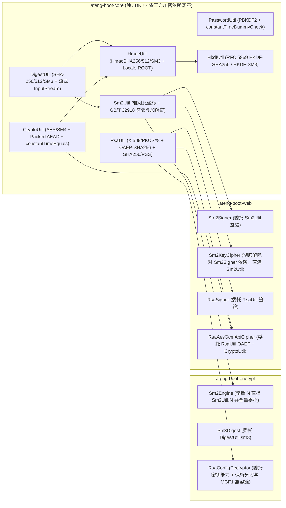

# ADR-0113: 核心底座纯原生密码学原语（RsaUtil / Sm2Util / HkdfUtil）下沉、存量加固与跨模块收敛架构

- **状态 (Status)**: `Accepted`（代码实施跟踪 GitHub Issue `#1183`、`#1184`）
- **日期 (Date)**: `2026-11-27`
- **关联模块 (Modules)**: `ateng-boot-core`、`ateng-boot-encrypt`、`ateng-boot-web`、`ateng-boot-samples/ateng-boot-sample-core`
- **演进溯源 (Extends / Relates to)**: 继承 [ADR-0011](./0011-zero-bloat-and-co-located-utilities.md)（100% 纯 JDK 17 零第三方加密库依赖）与 [ADR-0025](./0025-core-module-expansion-and-future-proof-middleware-foundations.md)（Core 通用底座收敛），联动并收敛 [ADR-0050](./0050-configuration-encryption-and-runtime-defense-architecture.md)（`ateng-boot-encrypt`）与 [ADR-0112](./0112-api-transport-hybrid-crypto-and-encrypt-then-sign-architecture.md)（`ateng-boot-web`）的底层非对称密码学实现。

---

## 1. 背景与痛点 (Context)

随着 `ateng-boot-core`、`ateng-boot-encrypt`、`ateng-boot-web` 与 `ateng-boot-mybatis-plus` 相继落地对称加密、配置加解密、API 双向加签与传输层混合加密能力，分散维护的密码学代码暴露出以下结构性缺陷与加固诉求：

1. **SM2 多副本实现导致严重常量漂移与包间反向耦合**：
   - `ateng-boot-encrypt` 的 `Sm2Engine` 与 `ateng-boot-web` 的 `Sm2Signer` / `Sm2KeyCipher` 各自独立实现椭圆曲线运算，已暴露 `Sm2Engine.N` 误多写一段 `FFFFFFFF`（288-bit 而非标准 256-bit，详见 `#1183`）的严重缺陷，同时 `Sm2Engine#multiply` 仍使用低效仿射坐标逐位求逆、`decrypt` 校验 `C3` 使用非恒定时间的 `Arrays.equals`，且 `encrypt` 对空明文会因 KDF 输出全零判断陷入死循环；
   - `ateng-boot-web` 中 `web.crypto.cipher.Sm2KeyCipher` 反向依赖 `web.sign.signer.Sm2Signer`，造成加解密与签名子包耦合。
2. **RSA 三处重复封装与 OAEP MGF1 参数分裂**：
   - `ateng-boot-encrypt` 的 `RsaConfigDecryptor` 与 `ateng-boot-web` 的 `RsaSigner`、`RsaAesGcmApiCipher` 各自重复实现 PEM 剥离、X.509/PKCS#8 解析与加解密/签名；
   - `RsaAesGcmApiCipher` 显式指定现代标准 `OAEP(SHA-256 + MGF1-SHA256)`，而 `RsaConfigDecryptor` 未传入 `OAEPParameterSpec`，在 JDK SunJCE 下实际使用历史 `OAEP(SHA-256 + MGF1-SHA1)` 且承担长配置分段加密与 `PKCS1Padding` 兼容职责，直接简单合并会破坏既有配置密文互通。
3. **标准密钥派生与实用封装缺口**：
   - `ateng-boot-core` 缺少 RFC 5869 标准 HKDF（`HKDF-SHA256` / `HKDF-SM3`）以支撑多用途子密钥域隔离派生，也缺少无填充 Base64URL、自包含封装版 AEAD（`*Packed`）、`SHA-512` / `HmacSHA512`、`InputStream` 流式增量摘要（防大文件 OOM）以及面向“账号不存在”分支的口令恒定时间伪校验能力。
4. **存量加密工具细节待加固且受既有异常契约约束**：
   - `CryptoUtil` 存在部分重载在异常消息中透传 `rootCause.getMessage()`、SM4-CBC/ECB 轮密钥未清零、`pkcs7Unpad` 错误信息拼接非法 `padLen`、SM4-GCM `gf128MultiplyInPlace` 存在逐位分支等问题；`HmacUtil.verifyHex` 未使用 `Locale.ROOT`；同时 `CryptoUtilTest` 与 `HmacUtilTest` 已锁定既有重载的异常类型契约，必须以零破坏方式完成安全加固。

---

## 2. 决策内容与落地设计 (Decision)

### 2.1 `#1183` 与 `#1184` 一体收敛及跨模块委托拓扑

将非对称密码原语（`RsaUtil`、`Sm2Util`）与标准密钥派生原语（`HkdfUtil`）下沉至 `ateng-boot-core` 统一治理，并一次性将 `#1183` 与 `#1184` 合并推进为连续闭环：先在 Core 落地标准雅可比投影坐标 `Sm2Util` 与 `RsaUtil`，再由 `ateng-boot-encrypt` 与 `ateng-boot-web` 统一委托收敛，消除重复施工与常量漂移。

- **SM2 收敛不变量**：`Sm2Engine` 与 `Sm2Signer` 保留全部既有 `public` 方法签名与嵌套载体类以保障源码及二进制向后兼容；`Sm2Engine.N` 直接引用 `Sm2Util.N`（标准 64 位十六进制 256-bit 曲线阶）；`ateng-boot-web` 包私有的 `Sm2KeyCipher` 彻底去除对 `Sm2Signer` 的跨子包依赖，直接委托 `Sm2Util`。
- **RSA 收敛不变量**：`RsaSigner`、`RsaAesGcmApiCipher` 与 `RsaConfigDecryptor` 均将密钥生成、PEM 编解码与 X.509/PKCS#8 解析统一委托至 Core `RsaUtil`。

### 2.2 `RsaUtil` 契约与 `RsaConfigDecryptor` MGF1 兼容性边界

1. **`io.github.atengk.boot.core.util.RsaUtil` 核心契约**：
   - **密钥生成与编解码**：提供 `generateKeyPair()`（默认 `2048`）与 `generateKeyPair(int keySize)`（仅允许 `2048` / `3072` / `4096`，拒绝弱密钥），返回标准 `java.security.KeyPair`；提供 `encodePublicKeyToPem` / `encodePrivateKeyToPem` / `encodePublicKeyBase64` / `encodePrivateKeyBase64`（私钥临时编码字节在 `finally` 抹零）。
   - **密钥解析边界**：统一解析 PEM / Base64 / DER 编码的 **X.509 公钥**与 **PKCS#8 私钥**；若检测到传统 OpenSSL **PKCS#1** 私钥（`BEGIN RSA PRIVATE KEY` 且非合法 PKCS#8 DER），立即快速失败抛出明确提示引导转换为 PKCS#8，不在 Core 中引入手工 PKCS#1 ASN.1 转换逻辑。
   - **现代单块加解密与双模签验**：`encryptOaep` / `decryptOaep` 严格锁定 `RSA/ECB/OAEPWithSHA-256AndMGF1Padding` + 显式 `OAEPParameterSpec("SHA-256", "MGF1", MGF1ParameterSpec.SHA256, PSource.PSpecified.DEFAULT)`（与 WebCrypto/OpenSSL 及 `ateng-boot-web` 对齐），并在加密前强制校验单块明文上限 `plaintext.length <= keyBytes - 66`；`signSha256` / `verifySha256` 采用 `SHA256withRSA`；`signPss` / `verifyPss` 锁定 `RSASSA-PSS` + `PSSParameterSpec("SHA-256", "MGF1", MGF1ParameterSpec.SHA256, 32, 1)`。
2. **`RsaConfigDecryptor` 兼容分层**：
   - 将密钥生成、PEM 编解码与密钥解析委托至 `RsaUtil`，保留面向配置文件长文本密文的分段加解密职责；
   - `decrypt` 兼容探测链按安全优先级升级为 **`OAEP(MGF1-SHA256)` $\rightarrow$ 历史 `OAEP(MGF1-SHA1)` $\rightarrow$ `PKCS1Padding`**，兼顾现代加密工具产出的密文与历史配置密文；
   - `RsaConfigDecryptor.encrypt` 保持既有 JDK 默认 `OAEP(MGF1-SHA1)` 行为，确保微服务灰度滚动升级期间旧版本实例仍可无损解密新加密的配置项。

### 2.3 `Sm2Util` 数据模型、线缆格式与空明文防卫

1. **不可变载体模型**：在 `io.github.atengk.boot.core.util.Sm2Util` 内定义 `public record Sm2Point(BigInteger x, BigInteger y)`（含 `INFINITY`、`isInfinity()`、`toUncompressedBytes()`、`toCompressedBytes()`、`toHex()`）与 `public record Sm2KeyPair(BigInteger privateKey, Sm2Point publicKey, String privateKeyHex, String publicKeyHex, String privateKeyBase64, String publicKeyBase64)`。
2. **曲线参数与采样校验**：采用 GB/T 32918.5-2017 标准 256 位推荐参数与雅可比投影坐标系点乘；生成私钥 $d$ 与加密随机数 $k$ 均采用拒绝采样，确保 $d \in [1, N - 2]$、$k \in [1, N - 1]$ 无模偏差；入口校验 `isOnCurve(pubKey)` 与私钥标量范围 $[1, N - 2]$；支持 Hex / Base64 / PEM / X.509 DER / PKCS#8 DER 密钥解析（含压缩公钥解压与 `0x04` 非压缩坐标）。
3. **加解密与空明文防卫**：
   - 遵循 GB/T 32918.4-2016，加密默认输出标准 `C1C3C2`（`0x04 || X1 || Y1 || C3 || C2`），同步提供 `encryptToDer` 与双向无损转换 `c1c3c2ToDer` / `derToC1c3c2`（修正原 `Sm2Engine` 仅支持到 `0x82` 65535 字节的 DER 长度写入限制，完整支持标准多字节长编码）；
   - 解密自动探测 `0x30`（ASN.1 DER）与 `C1C3C2`（兼容 65 字节 `0x04` 头与 64 字节裸 `C1`），使用 `MessageDigest.isEqual` 执行恒定时间 `C3` 摘要校验；
   - 对 `null` 或空字节数组明文严格快速失败抛出 `IllegalArgumentException`，彻底根除原 `Sm2Engine` 对空明文触发 `allZero == true` 无限死循环的缺陷。
4. **SM2/SM3 签验默认线缆契约**：内置标准默认 `userId = "1234567812345678"` 并提供自定义 `userId` 重载计算 $Z_A$；`sign` / `signBase64` 默认输出 **ASN.1 DER**（与 `Sm2Signer` 既有线缆格式 100% 保持一致），另提供 `signRaw`（64 字节 `r || s`）与 `derSignatureToRaw` / `rawSignatureToDer` 互转；`verify` 自动兼容 ASN.1 DER 与 Raw 64B 签名格式。

### 2.4 `HkdfUtil`（RFC 5869）与存量密文零扰动边界

- **新增 `io.github.atengk.boot.core.util.HkdfUtil`**：复用 `HmacUtil` 纯原生实现 `HKDF-SHA256`（默认方法名 `extract` / `expand` / `deriveKey`）与国密 `HKDF-SM3`（`extractSm3` / `expandSm3` / `deriveKeySm3`），均提供 `byte[] info` 与 `String info`（UTF-8）重载。
- **边界与内存卫生**：`salt` 为 `null` 或空数组时严格按 RFC 5869 §2.2 填充 32 字节 `0x00`；`ikm` 为空、`prk.length < 32` 或目标长度 `length` 不在 `[1, 255 * 32]` 区间均快速失败抛出 `IllegalArgumentException`；全部中间 `PRK`、`T(i)` 临时缓冲在 `finally` 块强制清零。
- **存量密文零扰动边界**：本轮仅在 `ateng-boot-core` 交付 `HkdfUtil` 原语及 Sample/文档域隔离用法，**不修改** `ateng-boot-encrypt` 的 `KeyDerivationHelper` 与 `ateng-boot-mybatis-plus` `EncryptTypeHandler` 的 `v1:` 历史密文方案，确保既有密文数据 100% 零迁移风险。

### 2.5 存量加密工具补全、侧信道加固与双轨异常契约

1. **向后兼容双轨异常契约**：
   - **存量既有重载**：严格保留 `CryptoUtil`（`byte[]` 与 3 参 `String` 抛 `IllegalStateException`，4 参带 AAD `String` 抛 `BusinessException`）与 `HmacUtil`（`hmacSm3` 抛 `BusinessException`，`hmac`/`hmacSha256`/`hmacSha1`/`hmacMd5` 抛 `NullPointerException` / `IllegalArgumentException`）的既有异常类型契约，**统一剥离所有异常消息体中拼接的底层 `rootCause.getMessage()` / `e.getMessage()`**，保留完整 `cause` 链并在 Javadoc 显式声明；
   - **全部新增原语（`RsaUtil`、`Sm2Util`、`HkdfUtil`、`CryptoUtil.*Packed`、`DigestUtil(InputStream)`、`HmacUtil.hmacSha512*`）**：统一采用纯 JDK 底座分层异常契约——参数/格式/越界/明文超长抛出 `IllegalArgumentException`；加解密/认证 Tag/`C3` 校验/签名计算失败抛出消息脱敏的 `IllegalStateException`（100% 保留原始 `cause` 链，交由 `ateng-boot-web` 等上层按场景转译）；流式读取 I/O 异常抛出 `UncheckedIOException`。
2. **`CryptoUtil` 增强与侧信道加固**：
   - 新增无填充 `encodeBase64Url(byte[])` / `decodeBase64Url(String)`、恒定时间比对 `constantTimeEquals(byte[], byte[])` / `constantTimeEquals(String, String)`（任一 `null` 返回 `false`），以及自包含封装版 AEAD 方法 `encryptGcmPacked` / `decryptGcmPacked`、`encryptSm4GcmPacked` / `decryptSm4GcmPacked`（自动生成 12 字节随机 IV、输出 `12B IV || ciphertext || 16B Tag`、解密强制校验长度 `>= 28` 字节、支持可选 `aad`）；`*Packed` 的 `String` 重载与 `CryptoUtil` 既有字符串方法一致采用标准 Base64 编码；
   - 补齐 `encryptSm4Cbc` / `decryptSm4Cbc` / `encryptSm4Ecb` / `decryptSm4Ecb` 的 `rk` / `invRk` 轮密钥及临时数组 `finally` 清零；
   - 泛化 `pkcs7Unpad` 异常消息，不再暴露具体非法 `padLen` 以降低 Padding Oracle 信息泄漏风险，并在 Javadoc 明确提示优先选用 GCM 认证加密；
   - 将 SM4-GCM `gf128MultiplyInPlace` 升级为基于 64 位 `long` 的无分支恒定时间 `GF(2^128)` 乘法实现（消除逐位条件分支 `if`），同步校验 NIST SP 800-38D 与大载荷/空明文/AAD 向量；
   - 修复 RFC 8998 标准向量验证中发现的存量 `SM4_CK[5..31]` 常量错位缺陷（索引 5 起由 `0x8c939a01` 修正为 GB/T 32907-2016 标准 `0x8c939aa1` 及后续 26 项），恢复 SM4-ECB/CBC/GCM 与 OpenSSL/BouncyCastle/RFC 8998 100% 互操作。
3. **`DigestUtil`、`HmacUtil` 与 `PasswordUtil` 补强**：
   - `DigestUtil`：新增 `sha512` / `sha512Hex` 及 `sha256` / `sha512` / `sm3`（含 `*Hex`）的 `InputStream` 流式增量摘要（固定 8KB 缓冲区，**不关闭**调用方传入流，入参 `InputStream == null` 快速失败抛 `IllegalArgumentException`）；内部抽取 `Sm3State` 增量状态机，同步改造 `sm3(byte[]... parts)` 消除整块拼接内存拷贝；
   - `HmacUtil`：新增 `HMAC_SHA512`（`hmacSha512` / `hmacSha512Hex` / `hmacSha512Base64`）；`verifyHex` 改为 `toLowerCase(Locale.ROOT)` 消除非英文 Locale（如土耳其语 `tr-TR`）大小写陷阱；`verify` 底层复用 `CryptoUtil.constantTimeEquals`；
   - `PasswordUtil`：新增 `constantTimeDummyCheck`（提供 `CharSequence` / `char[]` 及指定 `iterations` 重载，固定返回 `false`），当入参为空或空白串时使用内置固定占位口令执行同等迭代次数 PBKDF2 运算，便于认证流程在“账号不存在”分支直接防御时序枚举。

---

## 3. 被拒绝的备选方案 (Considered Options)

1. **拒绝破坏性统一存量 `CryptoUtil` / `HmacUtil` 异常类型**：
   - 既有单测与上层调用方（如 `ApiCryptoFilter` / `RsaAesGcmApiCipher`）已分别依赖 `decryptGcm(byte[])` 抛 `IllegalStateException` 与 4 参 `decryptGcm(String, ..., aad)` 抛 `BusinessException`（以及 `hmacSha256` 抛 NPE、`hmacSm3` 抛 `BusinessException`）。保持存量方法异常类型不变仅脱敏消息、并在新原语上统一契约，可实现零回归升级。
2. **拒绝在 Core `RsaUtil` 中纳入 PKCS#1 私钥解析、长文本分段加密与 `MGF1-SHA1` 兼容分支**：
   - 分段 RSA 加密与 `PKCS1Padding` / `MGF1-SHA1` 仅服务于 `ateng-boot-encrypt` 既有静态配置解密兼容，非现代加密最佳实践（现代长报文应使用混合加密 `RSA-OAEP + AES-GCM`）。将其留在 `RsaConfigDecryptor` 可保持 Core 原语纯净且避免误导新业务采用弱填充。
3. **拒绝将 `*Packed(String)` 默认编码设为 Base64URL**：
   - `CryptoUtil` 全量既有的字符串加解密方法均返回标准 Base64 并配合 `CryptoUtil.decodeBase64` 使用；若唯独 `*Packed(String)` 输出 Base64URL，极易在混用 `decodeBase64` 时触发非法字符异常。调用方在 URL/Cookie 场景可显式组合 `encodeBase64Url(encryptGcmPacked(...))`。
4. **拒绝在本轮同步改造 `EncryptTypeHandler` 为 `HkdfUtil` 双版本密文，以及暂不在 `PasswordUtil` 引入纯 Java `$pbkdf2-sm3$`**：
   - 持久层加密密钥轮换与双版本格式迁移涉及历史存量数据兼容规划，宜独立评估；而纯 Java 执行 31 万次 `HmacSM3`（62 万次 SM3 压缩）缺少 JDK 硬件指令加速且迭代基线需独立压测校准，故先交付高频必需的 `constantTimeDummyCheck`，待有明确信创口令合规需求再单独推进。

---

## 4. 后果与权衡 (Consequences & Trade-offs)

- **正向收益**：
  1. 彻底根除 `#1183` `Sm2Engine.N` 288-bit 常量漂移与空明文死循环隐患，统一使用高性能雅可比投影坐标并将全仓 SM2/RSA 原语收敛至 `ateng-boot-core`，同时消除 `web.crypto` 对 `web.sign` 的跨子包耦合；
  2. 以零外部依赖补齐工业级密钥派生（`HkdfUtil`）、流式防 OOM 摘要、自包含 Packed AEAD、Base64URL 与抗枚举 `constantTimeDummyCheck` 底座能力；
  3. 清除存量工具异常消息体中的底层细节拼接，补全 SM4 轮密钥清零与无分支 64 位 `GF(2^128)` 恒定时间乘法，同时 100% 保持既有测试与历史密文向后兼容。
- **妥协与约束**：
  1. 因保留既有方法异常类型以换取向后兼容，调用 `CryptoUtil.decryptGcm` 的 3 参/4 参 `String` 重载在异常类型上仍存在历史差异（已通过脱敏与完整 Javadoc 显式说明区分）；
  2. `RsaUtil.parsePrivateKey` 要求现代 PKCS#8 格式输入，外部传统 OpenSSL PKCS#1 私钥需在接入前完成格式转换；
  3. 修复 `CryptoUtil.SM4_CK[5..31]` 为 GB/T 32907-2016 标准轮常量以实现与 OpenSSL / BouncyCastle / RFC 8998 100% 互通；若升级前曾使用历史缺陷版本持久化过 SM4-CBC/ECB/GCM 静态密文（如 `ENC(SM4-CBC@...)`），升级后需按标准 SM4 重新生成密文；
  4. 本决策确立后，后续代码实施与 Sample-First 验证将严格按 `#1183` 与 `#1184` 验收清单推进。
