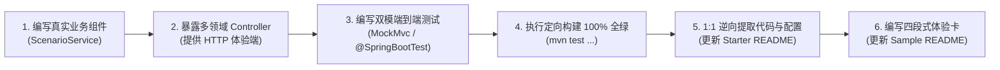

# 工业级文档与样例工程标准规范 (Documentation & Sample Specification)

## 1. 核心定位与唯一真理源职责 (Mission & Scope)

在 `ateng-boot` 框架中，**文档与样例工程（Sample）是连接框架能力与终端开发者（及 AI 编程助手）的第一生命线**。本规范作为全仓库子模块文档（`ateng-boot-*/README.md`）、根目录门面与 AI 索引（`README.md`、`llms.txt`）及场景样例工程（`ateng-boot-samples/ateng-boot-sample-*`）的**唯一权威标准（Single Source of Truth）**，同时定义了交付准出的《12 项成熟度与文档双向对齐自检清单》与 `/code-review` 红牌阻断门禁。

---

## 2. Starter 模块 `README.md` 五维生产就绪规范 (The 5D Starter Document Invariant)

子模块根目录下的 `README.md` 是该模块对外唯一权威的**“全功能契约真理源”**。任何新增或修改的功能特性，必须正交覆盖以下 **五个维度（维度零 ~ 维度四）** 与章节结构：

### 2.1 标准大纲骨架与五维交付要求

```markdown
# ateng-boot-<module> <中文功能全称>

> 一句话核心价值宣言：阐明核心技术栈与面向的典型企业级场景。

---

## 0. 特性与公共 API 全景速查矩阵 (维度零：100% 全覆盖)

| 特性分类 | 特性名称 | 核心门面 / 注解 / SPI | 关键配置项 (`ateng.boot.*`) | 关键 API 签名 / 核心行为 | 锚定验证源头 (*Test / Sample) |
| :--- | :--- | :--- | :--- | :--- | :--- |

## 1. 模块定位与快速起步 (维度一：最小可用配置与极简实战代码)

## 2. 核心架构与设计不变量 (架构图 / 拓扑 / 核心原理)

## 3. <业务能力领域大章一> (按能力领域聚合收敛)
   ### 3.1 <核心子特性 A> (配置 + 代码 + 原理边界三要素就近闭环)
   ### 3.2 <核心子特性 B>

## 4. <业务能力领域大章二>
   ...

## N-1. 生产扩展接管与核心非功能边界 (维度二：SPI/Bean 定制接管；维度三：并发/事务/超时/防 OOM 边界)

## N. 完整 YAML 配置属性清单 (全量速查附录)
```

- **维度零（100% 全景速查矩阵刚性铁律）**：模块对外暴露的所有公共门面类（`*Template` / `*Executor` / `*Util` / `*Manager` 等）及 Public 方法、声明式核心注解（`@*`）及关键属性、配置属性类（`@ConfigurationProperties`）所有配置项、扩展点接口（SPI / Callback / Listener / Provider），**必须 100% 在第 0 节全景矩阵中收录**，彻底杜绝“代码写了但文档未记录”的隐形死代码。
- **维度一（最小起步体验 Happy Path）**：直击一句话痛点，必须给出标准 **Maven `<dependency>` 引入坐标**（同时覆盖导入 BOM 免版本号写法与独立显式版本写法），并配套最小可用配置与开箱即用的极简实战代码。
- **维度二（生产扩展接管 Customization & Extensibility）**：显式展示当默认行为无法满足定制诉求时，如何通过实现 SPI 接口、`@ConditionalOnMissingBean` 覆盖默认 Bean、订阅领域事件或注册自定义拦截器进行生产接管。
- **维度三（核心生产边界与非功能语义 Production Boundary & Failure Modes）**：显式声明高并发、分布式或极端异常场景下的底层机制（如事务可见性、幂等与死信防雪崩、锁续期与安全释放、网络超时熔断、流式防 OOM 阈值等）。
- **维度四（物理排版与全真逆向验证 Evergreen & Zero-Glitch）**：见 2.5 与 2.6 节。

---

### 2.2 章节“三要素就近闭环”铁律 (Co-located 3-Element Invariant)

**【红线阻断项】** 每个具体业务特性小节（如 `3.1`、`3.2`）必须在**当前屏幕内**同时提供以下三要素，严禁“正文只写 Java 调用，配置扔在几百行后文末”：

1. **本节专属 YAML 配置片段**：仅展示当前特性所需配置项，标配中文注释与生产合理默认值，键名与 `@ConfigurationProperties` 字段逐字对齐；
2. **面向实战的业务 Java 示例**：100% 逆向提取自已在 Sample 中跑通的真实业务代码；
3. **核心机制与边界防御说明**：讲透默认超时、防重入、异常回滚、降级 fallback 等底层行为。

> **注**：文末《完整 YAML 配置属性清单》仅作为全量属性速查字典，严禁作为配置项的唯一暴露点。

---

### 2.3 “能力领域大章”收敛架构 (Capability Domain Aggregation)

**【红线阻断项】** 同类功能强制按业务能力领域聚合为**一级大章**，下设二级小节；严禁因开发批次不同在文档末尾随意追加零碎割裂的小章节。
- **正确示范**：`第 4 章：分布式并发协同套件`（4.1 声明式防超卖锁、4.2 多键联锁 MultiLock、4.3 慢锁审计与降级）；`第 5 章：多级缓存与全景防卫套件`（5.1 多级 TTL 缓存管理、5.2 防击穿模板、5.3 L1+L2 两级协同）。

---

### 2.4 真实业务语义场景驱动 (Real-World Business Semantics)

**【红线阻断项】** 严禁将单元测试中的测试桩代码（如 `key1`、`test/123456`、`"NORMAL_SUCCESS_" + id`、单方法内自加锁测重入）复制到 Sample 或文档中。所有 Sample 与文档示例必须演进为真实高频业务模型：
- **并发锁**：秒杀商品库存扣减防超卖（`deductStock`）、订单防重复支付；
- **延时队列 / 调度**：未支付订单 30 分钟超时自动关单（`OrderDelayPayload`）；
- **消息流 / 广播**：物流轨迹事件投递与消费组削峰（`LogisticsTrackEvent`）；
- **防重幂等**：第三方支付回调防重入（`PaymentCallbackRequest`）；
- **两级缓存 / 检索**：热点商品详情查询、跨天业务流水号生成。

---

### 2.5 代码与配置源头全真逆向提取 (Source Truth Anchoring)

1. **Sample-First 绝对前置工序**：编写或更新子模块 `README.md` 前，**必须先完成对应 Sample 场景组件、多 Controller 接口与端到端测试的编写并确保 `mvn test` 全绿**。未在 Sample 中跑通的特性严禁写入文档。
2. **1:1 逆向提取**：`README.md` 中的 Java 代码、YAML 配置及控制台/SQL/HTTP 响应输出，必须 100% 截取自已跑通的 Sample 源码与真实测试输出，严禁凭空手敲伪代码或脑补输出。

---

### 2.6 文档排版防裂守卫 (Markdown Integrity Guard)

1. **表格管道符与泛型防护**：Markdown 表格单元格内凡涉及泛型（如 `Map<String, Object>`）、位运算或管道符（`|`），必须使用行内代码反引号包裹（`` `Map<String, Object>` ``）或转义（`\|`），严禁导致表格错位破损；
2. **代码块反引号阶梯**：外层包含内层代码块时，外层必须使用四反引号（```` ````markdown ````）包裹内层三反引号（```` ```bash ````），且开闭标签 100% 成对闭合；
3. **纯相对路径互链**：文档内链接 100% 采用相对路径（`./`、`../`），严禁在 Markdown 正文中写入 `file:///` 或带本地盘符（`C:/`、`D:/`）的绝对路径。

---

### 2.7 零源码依赖治理构件定制规范 (`DependencyGovernanceArtifact`)

`ateng-boot-bom`（`<packaging>pom</packaging>`）与 `ateng-boot-all`（`<packaging>jar</packaging>` 零编译源码）作为全局依赖管控与全家桶聚合构件，不暴露传统 Java 业务类与 `@ConfigurationProperties`，其五维 `README.md` 遵循以下专职等价映射，且第 1 节必须提供同步至最新稳定版的标准 Maven 引入坐标：

1. **`ateng-boot-bom`（BOM 管控清单，`packaging=pom`）五维骨架**：
   - **第 0 节（维度零：100% 全量纳管坐标全景速查矩阵）**：按领域完整列出 BOM 显式声明的全部 `io.github.atengk:*` Starter 坐标、第三方核心中间件坐标与锁定版本号（包含 `spring-boot-dependencies` 基准对齐），并声明**内部依赖与测试替身防泄漏隔离清单**（由 `mvn help:effective-pom -f ateng-boot-bom/pom.xml` 验证）。
   - **第 1 节（维度一：最小可用引入与快速起步）**：给出非侵入式 `<type>pom</type><scope>import</scope>` 标准 Maven 声明（`<artifactId>ateng-boot-bom</artifactId>` 紧随 `<version>`），说明多模块微服务统一导入范式。
   - **第 2 节（维度二：依赖边界、隔离与定制覆盖机制）**：阐明 Parent vs BOM Import 解耦契约、本地版本显式覆盖（属性/声明前置优先）与 `<exclusions>` 剔除模式。
   - **第 3 节（维度三：按业务拓扑组装 Starter 组合配方）**：提供纯后端 API、有状态数据应用、异步/消息微服务等场景化按需组装建议。
   - **第 4 节（维度四：基线兼容性矩阵与高频冲突排障）**：锁定 JDK、Spring Boot 与核心引擎基线版本（参见 [ADR-0006](../adr/0006-dependency-baseline-and-upgrade-strategy.md)），给出冲突排查命令（`mvn dependency:tree`、`mvn help:effective-pom`）。
   - *Sample 映射*：纯 POM 清单无运行时行为与 HTTP 端点，豁免独立专职 Sample（由 `ateng-boot-samples` 统一通过 `<scope>import</scope>` 反向验真）。
2. **`ateng-boot-all`（全景核心聚合全家桶，`packaging=jar` 零编译源码）五维骨架**：
   - **第 0 节（维度零：核心捆绑成员与按需扩展选型矩阵）**：精确列出默认透传的 **6 大核心 Starter**（`core`、`web`、`mybatis-plus`、`redis`、`excel`、`satoken`），并给出未纳入默认绑定、需按需独立引入的全仓剩余业务 Starter 完整选型对照表。
   - **第 1 节（维度一：Maven 引入与最小可用体验）**：提供“BOM + `ateng-boot-all` 免版写法”与“独立显式版本号写法”（`<artifactId>ateng-boot-all</artifactId>` 紧随 `<version>`），并逆向提取自 [`ateng-boot-sample-smoke-test`](../../ateng-boot-samples/ateng-boot-sample-smoke-test/README.md) 的最小可用配置与核心契约演示代码。
   - **第 2 节（维度二：聚合装配拓扑与零冲突协调原理）**：展示 6 大底座通过 Core 四维上下文、SPI 自动桥接与 `@AutoConfiguration` 有序装配构成的协同架构（严禁遗留已退役第三方库引用）。
   - **第 3 节（维度三：全真跨模块端到端闭环场景）**：基于 `ateng-boot-sample-smoke-test` 跑通的真实闭环（统一响应/校验 -> Sa-Token 登录上下文自动透传 -> MyBatis-Plus 审计与 `PageResult` 分页 -> Apache Fesod 脱敏流式导出），展示多模块无胶水联动。
   - **第 4 节（维度四：适用边界、局部排除与拆分演进指南）**：明确适用单体/快速原型边界，提供 `<exclusions>` 精确剔除不需要默认底座（如剔除 `redis` 或 `excel`）的配方及向微服务拆分迁移路径。
   - *Sample 映射*：严格 1:1 锚定 [`ateng-boot-samples/ateng-boot-sample-smoke-test`](../../ateng-boot-samples/ateng-boot-sample-smoke-test/README.md)（多领域 Controller `/sample/smoke/...` + 按需 Starter 共存门禁 + Redis 双模降级）。

---

### 2.8 根目录门面文档 (`Root Storefront README.md`) 与 AI 索引 (`llms.txt`) 边界规范

根目录 [`README.md`](../../README.md) 与 [`llms.txt`](../../llms.txt) 是面向终端开发者选型与外部 AI 编程助手检索的**“项目第一门面与全景索引枢纽”**，**严禁复用 Starter 5D 长篇契约或演变为内部工程治理看板**：

1. **门面去噪与禁区红线**：根目录 `README.md` **严禁堆砌全量 ADR 决策清单、40 行级特性痛点-ADR 矩阵、以及内部开发流程/提交流水线细则**；全量 ADR 收口至 [`docs/adr/README.md`](../adr/README.md)，模块上下文边界收口至 [`CONTEXT-MAP.md`](../../CONTEXT-MAP.md)，贡献与研发规范收口至 [`CONTRIBUTING.md`](../../CONTRIBUTING.md)，首页底部仅保留 1 组极简相对路径导航链接。
2. **标准门面五段结构**：
   - **第一屏价值宣言与能力全景**：高信噪比全局徽章（含 `Starters` 与 `llms.txt` 入口）、核心选型亮点与高层次领域架构图；
   - **60 秒极速上手**：提供 `ateng-boot-all` 与 `ateng-boot-bom` 双模 Maven 引入坐标（**`<artifactId>ateng-boot-(all|bom)</artifactId>` 必须紧邻下一行 `<version>...</version>`**，确保 [`scripts/release.sh`](../../scripts/release.sh) 自动原地更新版本号）、10 行级真实可用示例与离线 Sample 一键启动命令；
   - **分领域模块目录**：按业务能力域拆分为简洁 3 列表格（`ArtifactId` / 核心能力一句话定位 / 文档与 Sample 链接），100% 覆盖全部已分发模块与 `ateng-boot-samples`；
   - **AI-Ready 引导专章**：标注 `llms.txt`、`CONTEXT-MAP.md` 与子模块 `README.md` 寻址路径，并附开箱可用的短规则提示卡片；
   - **延伸阅读与参与贡献**：极简导航尾注。
3. **机读 AI 索引 (`llms.txt`) 双原则**：
   - **纯相对路径**：严格遵循 [llmstxt.org](https://llmstxt.org/) 分组格式，全量使用仓库相对路径（`./...`）索引全局文档与每个模块的 `README.md` / `CONTEXT.md` / Sample `README.md`，保障本地 AI IDE 与在线平台通用可读；
   - **免硬编码版本号**：`llms.txt` 不写死具体版本号，统一引导 AI 从根 `pom.xml` 或 `ateng-boot-bom/README.md` 获取版本真源，避免跨发版维护漂移。

---

## 3. Sample 场景样例工程规范 (The Sample Engineering Invariant)

场景样例工程（`ateng-boot-samples/ateng-boot-sample-<module>`）与业务 Starter（`ateng-boot-<module>`）严格 **1:1 映射**，各 Sample 之间恪守**零共享代码（Zero-Shared-Code）**与非分发隔离（`<maven.deploy.skip>true</maven.deploy.skip>`）。

### 3.1 全面 Web 体验化与多 Controller 领域拆分

1. **统一引入 Web 底座**：所有 Sample 工程在 `pom.xml` 中统一引入 `io.github.atengk:ateng-boot-web`，启动应用即可通过 HTTP/cURL/Swagger 交互体验。
2. **按业务领域拆分多 Controller**：能通过 HTTP 调用的功能必须**全量暴露为 `@RestController` 接口**，并按功能领域拆分为多个高内聚 Controller（如 `RedisLockController`、`RedisCacheController`、`RedisDelayQueueController`），**严禁编写单一臃肿胖 Controller**。
3. **主动操作 vs 被动监听的暴露规则**：
   - **主动操作类**（锁、缓存、幂等、布隆、限流、发号、CRUD、检索等）：直接提供触发并返回执行结果的 Controller 接口；
   - **被动监听类**（延时队列监听、MQ/Stream 消费者、Pub/Sub 订阅、定时任务）：由 Controller 提供**“生产投递/手动触发端”**与**“死信/待决状态查询运维端”**。
4. **路由与响应契约**：统一采用 `/sample/<module>/<feature>/<action>` 语义化路由；入参使用 DTO/Request（严禁暴露持久层 Entity），出参显式返回强类型 `Result<T>`。

---

### 3.2 Sample 模块 `README.md` 四段式极简体验卡模板

Sample 自身的 `README.md` 统一定位为**“启动与接口体验卡”**，**严禁重复抄录 Starter 的全景矩阵与长篇架构原理**，严格采用以下四段式结构：

````markdown
# ateng-boot-sample-<module> <场景全称>体验工程

> 专注于演示与自验 `<module>` 核心特性在真实业务场景下的开箱使用。

---

## 1. 快速启动与服务端口

- **默认 HTTP 端口**：`8080` (可在 `application.yml` 中修改)
- **启动方式**：
  ```bash
  # 方式一：IDE 中运行 Sample<Module>Application.java 的 main 方法
  # 方式二：命令行启动
  mvn spring-boot:run -pl ateng-boot-samples/ateng-boot-sample-<module>
  ```

---

## 2. 运行环境与双模切换

- **默认/CI 模式**：内置 `@Profile("!local")` 离线内存桩与自洽配置，无需外部依赖即可启动与跑通测试；
- **Local 真实模式**：若需连接真实中间件，复制 `src/main/resources/application-local.example.yml` 为 `application-local.yml` 并填入真实连接信息（已被 Git 忽略，CI 零风险），激活 `local` Profile 启动即可直连测试。

---

## 3. 核心 Controller 接口与一键体验

| 功能场景 | Controller 类 | 请求方式与路径 | 快速体验 cURL 命令 |
| :--- | :--- | :--- | :--- |
| **分布式锁扣减库存** | `RedisLockController` | `POST /sample/redis/lock/deduct-stock` | `curl -X POST "http://localhost:8080/sample/redis/lock/deduct-stock?productId=1001&count=2"` |

---

## 4. 全真自动化回归命令

```bash
mvn test -pl ateng-boot-<module>,ateng-boot-samples/ateng-boot-sample-<module> -am -T 1C -nsu -B
```

> 详细原理机制、配置清单与扩展定制，请参阅核心 Starter 文档：[ateng-boot-<module> README](../../ateng-boot-<module>/README.md)。
````

---

## 4. “Sample-First” 逆向研发流与 12 项准出自检红线 (Audit Checklist & Red Card Gate)



### 📋 交付前成熟度与文档双向对齐自检清单 (The 12-Point Audit Checklist)

在每次特性交付或调用 `/code-review` 时，必须逐项核验以下 12 项卡点；**任何一项未通过直接触发 Red Card 阻断准出**：

- [ ] **1. Sample 100% 场景对齐**：模块新增/修改的所有公共 API 方法、核心注解、配置项与 SPI，是否已 100% 在归属的 `ateng-boot-sample-<module>` 中提供端到端可运行用例（依赖治理构件按下方口径映射核验）？
- [ ] **2. Sample 多 Controller 暴露**：能做成 HTTP 接口的功能是否已按业务领域拆分为多个独立 `@RestController`，统一遵循 `/sample/<module>/<feature>/<action>` 路由并返回 `Result<T>`？
- [ ] **3. Sample README 极简体验卡**：Sample `README.md` 是否严格遵循四段式结构（端口启动、双模切换、cURL 体验表、回归命令），无冗余原理与全景表抄录？
- [ ] **4. 依赖引入与三要素就近闭环**：Starter `README.md` 第 1 节是否已提供同步当前稳定版本的 Maven `<dependency>` 引入坐标（含 BOM 与独立版本说明）？各特性小节是否在同一屏幕内闭环“专属 YAML + 业务 Java 代码 + 机制边界”？同类功能是否按业务能力大章聚合收敛？
- [ ] **5. 真实业务语义场景驱动**：文档与 Sample 代码是否已演进为商品、订单、支付、物流等真实业务语义模型，彻底清零 `NORMAL_SUCCESS_`、`key1` 等单测试桩硬搬？
- [ ] **6. Sample-First 逆向提取**：Starter `README.md` 中的所有 Java 代码、YAML 配置与输出结果，是否 100% 逆向提取自已编译并实测全绿的 Sample 工程？
- [ ] **7. 维度零 100% 全景速查矩阵**：模块所有对外公共门面及 Public 方法、配置项、核心注解与 SPI（或 BOM/All 构件全部纳管/聚合坐标与按需选型表）是否 100% 收录进 Starter `README.md` 第 0 节全景矩阵？
- [ ] **8. 排版防裂与路径纯净**：表格内泛型/管道符是否已反引号包裹或转义？嵌套代码块是否遵循四反引号阶梯？文档内是否 100% 为相对路径且无死链？
- [ ] **9. 九道成熟度防线对齐**：源码是否全面满足 [`AGENTS.md`](../../AGENTS.md) 第 3 节九道防线（对称门面、前置 Fail-Fast、确定性资源清理、受管线程池与锁状态判断释放、`Duration`/`DataSize` 强类型配置、保留 `cause` 的因果异常转译、Core 原语复用与对抗性单测）？
- [ ] **10. 单测全自洽三铁律**：单测文件 IO 是否使用 `@TempDir`？ThreadLocal/MDC 上下文是否在 `@AfterEach` 无条件清理？默认模式是否 100% 离线自洽？
- [ ] **11. 远程服务双模真实验证**：若涉及远程中间件，Sample 是否提供 `@Profile("!local")` 内存桩与 `application-local.example.yml` 大写占位符模板？若本地具备真实服务，是否已在 `local` 模式下测通并清理现场（无环境则显式登记 `[豁免：无可用环境]`）？
- [ ] **12. 传输契约绝对解耦**：Controller 传输边界是否 100% 杜绝直接接收或返回持久层实体（Entity）？

> **[非代码依赖治理构件口径映射 (`ateng-boot-bom` / `ateng-boot-all`)]**：
> - **`ateng-boot-bom`**（纯 POM 清单）：第 1/2/3/5/6/9/10/11/12 项豁免运行时 Java/Sample/Controller 要求，第 4/7 项映射为“第 1 节 `<scope>import</scope>` 坐标 + 第 0 节全量纳管坐标与防泄漏隔离清单 + `mvn help:effective-pom -f ateng-boot-bom/pom.xml` 无内部/单测依赖泄露实测”。
> - **`ateng-boot-all`**（零编译源码聚合 JAR）：第 1/2/3/6/10/11/12 项 1:1 锚定 `ateng-boot-samples/ateng-boot-sample-smoke-test` 的多 Controller 集成校验、Redis `!local` 降级与 DTO/VO 隔离；第 4/7 项映射为“第 1 节 BOM/独立引入坐标 + 第 0 节 6 大 CoreBundle 与全部按需 Starter 选型对比矩阵 + `<exclusions>` 排除配方”。
