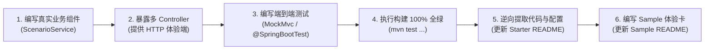

# 工业级文档与样例工程标准规范 (Documentation & Sample Specification)

## 1. 核心定位与设计哲学 (Mission & Scope)

在 `ateng-boot` 框架中，**文档与样例工程（Sample）是连接框架能力与终端开发者的第一生命线**。如果文档说得不清不楚、配置与代码脱节、示例充斥着脱离现实的单元测试桩，再强大的中间件底座也将沦为不可用的废铁。

本规范确立框架所有子模块文档（`ateng-boot-*/README.md`）与配套样例工程（`ateng-boot-samples/ateng-boot-sample-*`）的工业级工程标准与双向锚定体系，作为代码审查（`/code-review`）的一票否决红线（Red Card Block）。

---

## 2. Starter 模块 `README.md` 规范 (The Starter Document Invariant)

子模块根目录下的 `README.md` 是该模块对外唯一权威的**“全功能契约真理源”**。每个 Starter 的 `README.md` 必须严格遵循以下全局结构骨架与内容规范：

### 2.1 标准大纲骨架 (Standard Outline Architecture)

```markdown
# ateng-boot-<module> <中文功能全称>

> 一句话核心价值宣言：阐明核心技术栈与面向的典型企业级场景。

---

## 0. 特性与公共 API 全景速查矩阵 (100% 覆盖)

## 1. 模块定位与 Maven 坐标

## 2. 核心架构与设计不变量 (架构图 / 拓扑 / 核心原理)

## 3. <业务能力领域大章一> (按领域聚合收敛)
   ### 3.1 <核心子特性A>
   ### 3.2 <核心子特性B>

## 4. <业务能力领域大章二> (按领域聚合收敛)
   ...

## N. 完整 YAML 配置属性清单 (全量速查附录)
```

---

### 2.2 章节“三要素就近闭环”铁律 (Co-located 3-Element Invariant)

**【红线阻断项】** 严禁出现“正文只讲 Java 代码怎么调用，而关键配置却扔在几百行后的文末”的脱节现象！

每个具体的业务特性章节（二级或三级小节），必须且只能在**当前屏幕内**实现以下“三要素”自洽闭环：

1. **本节专属 YAML 配置片段**：
   - 仅展示当前特性所需的关键配置项；
   - 标配清晰的中文单行注释与生产合理默认值；
   - 键名必须与 `@ConfigurationProperties` 类字段逐字对齐。
2. **面向实战的业务 Java 示例**：
   - 展示如何通过注解或门面调用该特性；
   - 代码必须 100% 逆向提取自已在 Sample 中跑通的真实业务代码。
3. **核心机制与边界防御说明**：
   - 显式讲透底层机制（如默认超时、防重入、看门狗续期、锁误删防御、异常回滚、降级 fallback 等）；
   - 提示生产注意事项，消除非功能黑盒。

> **注**：文档末尾的《完整 YAML 配置属性清单》仅作为全量属性的集中速查字典，**绝对严禁**作为该模块配置的唯一暴露点！

---

### 2.3 “能力领域大章”收敛架构 (Capability Domain Aggregation)

**【红线阻断项】** 严禁因为开发批次不同而在文档末尾随意追加零碎的小章节！

必须按技术领域或业务主线将同类功能收敛为**一级大章**，并在大章下合理划分二级小节。例如：
- **正确示范**：
  - `第 4 章：分布式并发协同套件`（下设：4.1 声明式防超卖锁、4.2 多键联锁 MultiLock、4.3 慢锁审计与降级）
  - `第 5 章：多级缓存与全景防卫套件`（下设：5.1 多级 TTL 缓存管理、5.2 防击穿防雪崩模板、5.3 L1+L2 跨节点两级协同）
- **错误反例**：
  - 第 4 章讲分布式锁，第 12 章讲 `RedisCacheManager`，第 13 章讲 `RedisCacheTemplate`，第 14 章又讲两级缓存，结构七零八落。

---

### 2.4 真实业务语义场景驱动 (Real-World Business Semantics)

**【红线阻断项】** 坚决严禁将单元测试中的测试桩代码（Test Stubs）无脑复制到文档中！

- **反面教材（禁止出现在文档中）**：
  - 变量命名如 `key1`、`value1`、`test/123456`；
  - 返回生硬的测试字符串如 `"NORMAL_SUCCESS_" + id`、`"REENTRANT_SUCCESS_"`；
  - 在单个方法内自己给自己加锁验证可重入（纯为测试而测试，违背生产逻辑）。
- **正面范式（必须演化为真实高频业务模型）**：
  - **并发锁**：秒杀商品库存扣减防超卖（`deductStock`）、订单防重复支付；
  - **延时队列**：电商未支付订单 30 分钟超时自动关单（`OrderDelayPayload`）、会员到期提醒；
  - **Stream 消息流**：物流轨迹事件广播与消费组削峰（`LogisticsTrackEvent`）；
  - **防重幂等**：第三方支付异步通知回调防重入（`PaymentCallbackRequest`）；
  - **两级缓存**：热点用户档案查询（`UserProfileVO`）、系统高频字典缓存。

**演化原则**：以单元测试验证底层逻辑边界（白盒与对抗性验证），但暴露在 Sample 与文档中的业务代码，必须演进为具备清晰业务语义与生产参考价值的真实代码范式！

---

## 3. Sample 场景样例工程规范 (The Sample Engineering Invariant)

场景样例工程（`ateng-boot-samples/ateng-boot-sample-*`）是面向开发者的**“最小可运行沙箱与开箱体验工程”**。为了让开发者“启动即可直接验证与交互”，Sample 工程必须遵守以下铁律：

### 3.1 全面 Web 体验化与依赖标准

1. **统一引入 Web 底座**：
   - 所有 Sample 工程统一在 `pom.xml` 中引入 `io.github.atengk:ateng-boot-web`；
   - 原生具备强类型 `Result<T>` 响应包装、JSR-303 参数校验、全链路 MDC `traceId` 追踪与统一异常拦截能力。
2. **启动即调试**：
   - 开发者通过 `main()` 启动应用或 `mvn spring-boot:run` 后，能够直接在浏览器、Swagger 或使用 cURL 发起 HTTP 请求体验中间件功能。

---

### 3.2 多 Controller 领域拆分与暴露边界

能做成 Controller 接口的功能必须**全量暴露**，并按业务能力拆分为多个高内聚的 Controller，**严禁编写单一臃肿的 Controller**：

1. **Controller 拆分命名**：
   - 必须按功能领域拆分，例如在 `ateng-boot-sample-redis` 中：
     - `RedisLockController`：演示商品库存防超卖锁、多键联锁、锁超时降级；
     - `RedisCacheController`：演示热点防击穿查询、两级缓存读取、定向淘汰；
     - `RedisDelayQueueController`：演示订单延时关单任务投递、死信队列运维；
     - `RedisStreamController`：演示消息流发送、消费组状态查询；
     - `RedisIdempotentController`：演示支付回调防重提交等。
2. **主动调用 vs 被动监听的暴露边界**：
   - **主动操作类特性**（锁、缓存、幂等、布隆、限流、发号等）：直接提供触发并返回执行结果的 Controller 接口；
   - **被动消费/监听类特性**（延时队列监听 `@DelayedQueueListener`、Stream 消费者 `@RedisStreamListener`、Pub/Sub 订阅者）：
     - Controller 负责提供**“生产投递触发端”**（例如 `POST /sample/redis/delay-queue/send-order-cancel` 投递延迟任务，控制台后台消费者自动打印消费闭环日志）；
     - Controller 负责提供**“死信/待决状态运维端”**（例如 `GET /sample/redis/delay-queue/dlq/list` 查询死信队列积压）。
3. **接口契约与路由规范**：
   - **路由前缀**：统一采用 `/sample/<module>/<feature>/<action>` 语义化命名空间；
   - **响应契约**：接口一律显式返回强类型 `Result<T>`；
   - **自解释文档**：Controller 类与方法必须标注清晰的 JavaDoc，便于直接生成 Swagger 或供开发者查阅。

---

### 3.3 Sample 模块 `README.md` 四段式极简体验卡模板

Sample 自身的 `README.md` 必须从“长篇技术文档”彻底松绑，**严禁重复堆砌 Starter 的全景矩阵与底层原理**，统一定位为**“启动与接口体验卡”**，严格采用以下四段式模板：

````markdown
# ateng-boot-sample-<module> <场景全称>体验工程

> 专注于演示与自验 `<module>` 核心特性在真实业务场景下的开箱使用。

---

## 1. 快速启动与服务端口

- **默认 HTTP 端口**：`8080` (可在 `application.yml` 中修改)
- **启动方式**：
  ```bash
  # 方式一：IDE 中运行 Sample<Module>Application.java 的 main 方法
  # 方式二：命令行启动
  mvn spring-boot:run -pl ateng-boot-samples/ateng-boot-sample-<module>
  ```

---

## 2. 运行环境与双模切换

- **默认/CI 模式**：内置离线内存桩与自洽配置，无需启动任何外部依赖即可启动运行与跑通测试；
- **Local 真实模式**：若需连接真实物理中间件，复制 `src/main/resources/application-local.example.yml` 为 `application-local.yml` 并填入真实连接串，启动自动生效（该文件已被 Git 忽略，CI 零风险）。

---

## 3. 核心 Controller 接口与一键体验

应用启动后，可通过以下 cURL 命令或浏览器直接发起调用体验：

| 功能场景 | Controller 类 | 请求方式与路径 | 快速体验 cURL 命令 |
| :--- | :--- | :--- | :--- |
| **分布式锁扣减库存** | `RedisLockController` | `POST /sample/redis/lock/deduct-stock` | `curl -X POST "http://localhost:8080/sample/redis/lock/deduct-stock?productId=1001&count=2"` |
| **热点数据防击穿查询** | `RedisCacheController` | `GET /sample/redis/cache/product/{id}` | `curl "http://localhost:8080/sample/redis/cache/product/1001"` |
| **投递订单延时取消任务** | `RedisDelayQueueController` | `POST /sample/redis/delay-queue/send-order-cancel` | `curl -X POST "http://localhost:8080/sample/redis/delay-queue/send-order-cancel?orderId=ORD-20261103&delaySeconds=10"` |

---

## 4. 全真自动化回归命令

```bash
mvn test -pl ateng-boot-<module>,ateng-boot-samples/ateng-boot-sample-<module> -am -T 1C -nsu -B
```

> 详细原理机制、配置清单与扩展定制，请参阅核心 Starter 文档：[ateng-boot-<module> README](../../ateng-boot-<module>/README.md)。
````

---

## 4. “Sample-First” 逆向研发流与审查红线 (Review Redlines)

任何新特性的研发或存量特性的重构，必须严格按照以下顺序流动，前道工序未完成，严禁进入后道工序：



### 🚨 文档审查一票否决红线 (Red Card Checklist)

在 `/code-review` 审查中，凡触碰以下任一缺陷，直接出具 Red Card 阻断本次交付准出：

1. **【配置脱节红线】**：Starter 模块 README 章节中仅有 Java 代码，未就近提供该特性专属的 YAML 配置说明；
2. **【章节散落红线】**：同一技术领域的功能因为编写批次不同被切分为分散的多章，未进行聚合收敛；
3. **【测试桩生搬红线】**：文档或 Sample 中充斥着 `test/123`、`NORMAL_SUCCESS_` 等无现实意义的单元测试桩，未演进为商品、订单、支付等真实业务语义模型；
4. **【缺少 Controller 交互红线】**：Sample 工程仅有后台测试而无 Controller 接口，启动后无法通过 HTTP 交互体验；或将所有功能塞在一个单一庞大的 Controller 中；
5. **【Sample 文档膨胀红线】**：Sample 工程的 `README.md` 未遵循四段式极简体验卡模板，存在冗余的原理抄录或全景表格；
6. **【伪代码脑补红线】**：文档中的 Java 示例代码或配置未真实在 Sample 中编译通过并验证。
