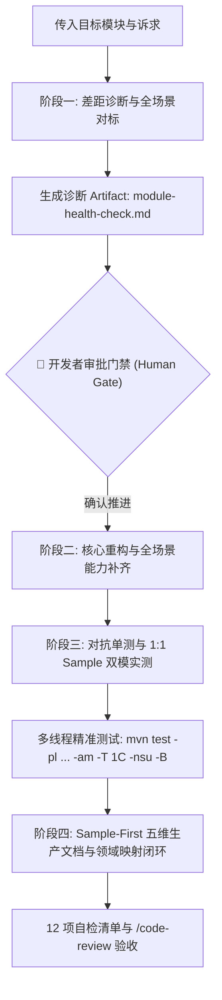

# 存量模块加固与全场景演进规范 (Module Hardening & Scenario Expansion SOP)

> 💡 **极简对话调用契约**：
> `@docs/agents/module-hardening-and-expansion.md <module-name> [optional-focus]`
> *示例：`@docs/agents/module-hardening-and-expansion.md redis 补齐延迟队列与滑动窗口限流`*

本规范专职约束**存量子模块从 1 到 N 的深度体检、行业主流场景对标、缺失能力补齐、鲁棒性加固与文档闭环**。

*(注：若需从 0 到 1 孵化全新模块，请遵循 [模块孵化与扩展通用标准](./modular-extensibility.md)。)*

---

## 1. 演进原则与架构红线引用

1. **行业全场景覆盖 (80%~90% Enterprise Coverage)**：对标该技术领域业界成熟标杆（如 Redisson、AWS S3、EasyExcel、Spring Kafka 等），主动推演并补齐企业级高频生产场景，优先挖掘已纳管底层驱动与 JDK 17 / Spring 6 原生算力，复杂定制通过专职 SPI 暴露，杜绝无脑引入第三方重型依赖。
2. **权威架构与文档红线（单一真理源引用）**：
   - **编码与成熟度红线**：100% 遵循全局 [`AGENTS.md`](../../AGENTS.md) 第 2 节（核心架构契约、防御性自动装配四铁律、BOM 统管、传输层 Entity 零泄露）与第 3 节（**工业级代码成熟度九道防线**）；
   - **文档与 Sample 体验红线**：100% 遵循 [`documentation-specification.md`](./documentation-specification.md)（Starter 五维文档模型、100% 全景速查矩阵、三要素就近闭环、能力大章收敛、真实业务语义模型、Sample 多 Controller 拆分与四段式极简体验卡、远程服务 `@Profile("!local")` 双模自适应）；
   - **最小变更与止损回滚准则**：严禁对无关历史代码进行大面积格式化重排；若重构导致大面积次生报错且连续排查受阻，立即使用 `git checkout` 回滚至干净状态重新推导设计树。

---

## 2. 四阶段流水线标准协议 (The 4-Phase Pipeline)



### 【阶段一：差距诊断与全场景对标（Gap Diagnosis & Scenario Benchmarking）】
1. **源码探查与标杆对标**：扫描 `ateng-boot-<module>` 源码、配置类、单测及 `ateng-boot-samples/ateng-boot-sample-<module>`，对标业界成熟方案梳理高频生产场景差距与九道防线隐患。
2. **生成专职诊断 Artifact**：在会话 Artifact 目录创建 `module-health-check.md`，包含：
   - **技术领域企业级全场景矩阵**（典型企业业务场景 | 业界主流最佳实践 | 当前模块现状 | 拟补齐落地方案）；
   - **九道成熟度防线与 Sample 多 Controller 合规差距表**；
   - **待补齐公共门面方法、配置项（`Duration`/`DataSize`）与扩展点 SPI 清单**；
   - **兼容性风险评估与分步实施路线图**。
3. **【🚨 人工审批硬门禁 (Human Gate)】**：向开发者汇报诊断结论与路线图后**必须立即停下**，等待开发者明确确认（如“确认推进”）后方可进入阶段二；**未获批准前严禁修改任何业务源码**。

---

### 【阶段二：核心重构与全场景能力补齐（Core Hardening & Scenario Expansion）】
获批后执行源码级加固：
1. 落地批准的缺失业务场景、对称门面方法与 SPI 扩展点，补充规范 JavaDoc、`@author Ateng` 与真实日期 `@since`；
2. 修复资源泄漏、并发竞争、无界等待与异常吞咽，确保底层异常转译为保留 `cause` 的语义化 `BusinessException`；
3. 校验配置属性（`Duration` / `DataSize` / `@NestedConfigurationProperty`）与自动装配守卫（`@AutoConfiguration` / `@ConditionalOnMissingBean`）。

---

### 【阶段三：对抗单测与 1:1 Sample 双模实测（Adversarial Testing & Sample Verification）】
1. **全自洽对抗单测**：遵循 [`AGENTS.md`](../../AGENTS.md) 第 4 节单测三铁律（`@TempDir`、`@AfterEach` 上下文清零、100% 离线自洽），覆盖空入参、边界超限、并发争用与失败回滚；
2. **1:1 Sample 多 Controller 与双模实装**：按 [`documentation-specification.md`](./documentation-specification.md) 第 3 节，在 `ateng-boot-sample-<module>` 中以真实业务语义建模，按领域拆分暴露多 `@RestController` 接口，完善 `@Profile("!local")` 离线桩与 `application-local.example.yml`；
3. **定向构建验证**：执行以下命令确保 100% 全绿（若本地配置了 `application-local.yml` 真实环境，同步执行 `-Dspring.profiles.active=local` 联调验证）：
   ```bash
   mvn test -pl ateng-boot-<module>,ateng-boot-samples/ateng-boot-sample-<module> -am -T 1C -nsu -B
   ```

---

### 【阶段四：五维生产文档与领域文档闭环（5D Documentation & Domain Sync）】
1. **逆向更新双端 `README.md`**：严格遵循 [`documentation-specification.md`](./documentation-specification.md) 第 2、3 节，从已跑通的 Sample 中 1:1 逆向提取代码、配置与实测输出，更新 Starter `README.md`（100% 全景矩阵 + 三要素就近闭环 + 能力大章收敛）与 Sample 四段式极简体验卡 `README.md`；
2. **领域与 ADR 同步**：同步更新 `ateng-boot-<module>/CONTEXT.md`、根 [`CONTEXT-MAP.md`](../../CONTEXT-MAP.md) 及归属 ADR（优先增量修订既有 ADR，参见 [`domain.md`](./domain.md)）；
3. **准出核验**：对照 [`documentation-specification.md`](./documentation-specification.md) 第 4 节《12 项自检清单》逐项核验并通过 `/code-review` 双轴审查，默认停留在工作区供开发者审阅。
