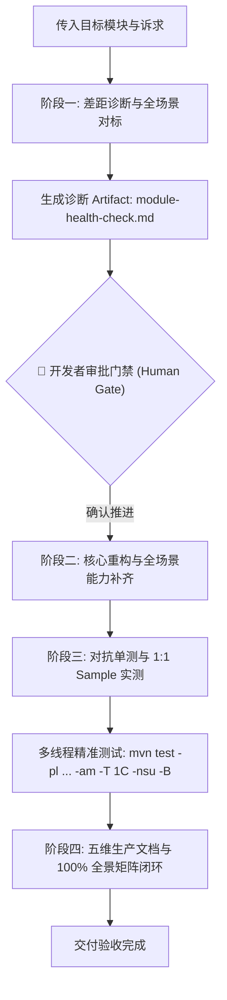

# 存量模块加固与全场景演进规范 (Module Hardening & Scenario Expansion SOP)

> 💡 **极简对话调用契约**：
> 在会话中直接引用本规范并传入目标模块名（及可选关注点）即可启动全流程：
> `@docs/agents/module-hardening-and-expansion.md <module-name> [optional-focus]`
> *示例：`@docs/agents/module-hardening-and-expansion.md redis 补齐延迟队列与滑动窗口限流`*

本规范作为 `ateng-boot` 官方工程标准之一，专职规范**存量子模块从 1 到 N 的工业级深度体检、行业主流场景对标、缺失能力补齐、鲁棒性加固与交付文档闭环**。凡对既有中间件模块进行重构或演进，一律受本协议强制约束。

*(注：若需从 0 到 1 孵化全新模块，请参阅 [模块孵化与扩展通用标准](./modular-extensibility.md)。)*

---

## 1. 演进原则与场景全覆盖定位

1. **行业全场景覆盖 (Full-Scenario Coverage)**：
   - 子模块必须对标该技术领域业界成熟方案（如 Redis 对标 Redisson/Spring Data Redis、Storage 对标 AWS S3/阿里云 OSS、Excel 对标 EasyExcel 等）；
   - 主动推演并覆盖排名前 80%~90% 的企业级典型高频生产场景，杜绝“代码漂亮但业务场景捉襟见肘”的半残 Starter。
2. **原生算力挖掘优先与零臃肿底座 (Native-First & Zero-Bloat)**：
   - 优先基于当前模块已纳管的底层驱动及 JDK 17 / Spring 6 原生算力实现高级场景（如利用高效 Lua 脚本、流式算法实现高级限流与切片），严禁为了覆盖边缘场景无脑引入第三方大包；
   - 复杂扩展场景通过专职 SPI 扩展点暴露，确保底座极速轻量。
3. **对称完备与开箱即用 (Symmetric & Out-of-the-Box)**：
   - 门面 API 必须读写对称、申请释放对称，提供声明式注解或高阶门面，确保业务接入层一句话开箱即用。

---

## 2. 核心红线与成熟度铁律 (Review Redlines)

执行本 SOP 时，触碰任一红线直接触发代码审查红牌阻断：
1. **九道成熟度防线**：
   - **对称语义完备性**：门面类（`*Template`/`*Manager`）操作必须完备对称，严禁只管申请不管释放或半残门面；
   - **分层防卫与快速失败**：核心逻辑前置显式卫语句（判空、判负、边界超限、非法状态拦截）；
   - **确定性资源清理**：流、网络连接、临时文件、ThreadLocal 等瞬态物理资源必须在 `try-with-resources` 或 `finally` 确定性释放；
   - **环境宿主中立**：严禁硬编码操作系统分隔符，防御过滤隐性系统文件；
   - **严格无状态与并发纪律**：单例无状态，严禁野线程（统一接入 Core 受管线程池），并发锁释放必须遵循持有状态判断范式；
   - **生产就绪配置与防悬挂**：超时与重试显式设限，时间统配 `Duration`，容量统配 `DataSize`，嵌套配置标配 `@NestedConfigurationProperty`；
   - **因果异常体系**：严禁吞咽异常与 Log-and-Throw，底层驱动异常转译为语义化 `BusinessException(IResultCode)` 且必须保留原始 `cause`；
   - **零臃肿与底座收敛**：通用原语优先复用 `ateng-boot-core`，坚决杜绝在子模块私造轮子；
   - **对抗性极限单测守护**：全真覆盖空入参、边界溢出、并发争用与配置开闭测试用例。
2. **传输层绝对解耦 (Zero-Entity-Leakage)**：Controller 传输边界 100% 严禁暴露 ORM 实体（Entity）。
3. **防御性自动装配四道铁律**：`@AutoConfiguration`、Spring Boot 3 标准 `imports` 注册、`@ConditionalOnMissingBean` 守卫、显式装配时序声明。
4. **BOM 依赖统管铁律**：严禁在子模块 `pom.xml` 中声明裸 `<version>` 标签；依赖必须在根 `pom.xml` 或 `ateng-boot-bom` 集中纳管。
5. **干净 Diff 守卫**：严禁对无关历史代码进行大面积排版或格式化重排，保持 Git Diff 干净最小。
6. **回滚止损准则**：若重构导致大面积次生报错且连续排查受阻，必须立即使用 `git checkout` 回滚至干净状态，退回设计树重新推导方案，严禁盲目向错误方向叠加补丁。

---

## 3. 四阶段流水线标准协议 (The 4-Phase Pipeline)



### 【阶段一：差距诊断与全场景对标（Gap Diagnosis & Scenario Benchmarking）】
1. **源码探查与标杆对标**：
   - 扫描目标模块 `ateng-boot-[MODULE_NAME]` 源码、配置类、单测以及配套样例 `ateng-boot-sample-[MODULE_NAME]`；
   - 深入调研该技术领域业界成熟实践，推演出该领域排名前 80%~90% 的企业生产高频场景清单。
2. **生成专职诊断报告**：在 Artifact 目录创建 `module-health-check.md`，必须包含：
   - **技术领域企业级全场景矩阵**（核心章节）：
     | 典型企业业务场景 | 业界主流与生产最佳实践 | 当前模块现状 (已具备 / 缺失待补齐 / 超出边界应拆分) | 拟补齐落地方案 (原生算力/SPI/轻量实现) |
     | :--- | :--- | :--- | :--- |
   - **九道防线合规差距对照表**（现状 vs 规范要求）；
   - **待补齐公共门面与扩展点 SPI 清单**；
   - **潜在生产隐患分析**（并发安全、连接泄漏、防无界悬挂、强类型配置缺失）；
   - **破坏性变更与兼容性风险评估**；
   - **实施路线图**。
3. **【🚨 人工审批门禁】**：在会话中输出《全场景对标摘要与补齐计划》，**并在此主动停下，等待开发者明确确认（“确认推进”）后方可进入阶段二！严禁擅自修改源码！**

---

### 【阶段二：核心重构与全场景能力补齐（Core Hardening & Scenario Expansion）】
在获得开发者明确批准后，执行源码级重构：
1. **全场景能力补齐**：落地阶段一批准的缺失业务场景，打造开箱即用的高阶门面与原生算法（如高效 Lua 脚本、流式分片器、重试退避器等）；
2. **对称门面与 SPI 扩展**：补齐缺失的对称方法与定制 SPI 扩展点，全量代码标配规范 JavaDoc、`@author Ateng` 与真实日期 `@since`；
3. **防御加固**：彻底修复资源泄漏与并发隐患，规范因果异常链抛出；
4. **配置与装配规范**：配置属性统配 `Duration`/`DataSize` 与 IDE 补全元数据，完善自动装配类的 `@ConditionalOnMissingBean` 守卫与 `imports` 注册。

---

### 【阶段三：对抗单测与 1:1 Sample 实测（Testing & Verification）】
1. **全自洽对抗单测**：使用 JUnit 5 原生 `@TempDir`，测试后严格清理上下文与现场，100% 离线自洽（纯内存/Mock/H2）；
2. **1:1 Sample 场景化实装**：在 `ateng-boot-samples/ateng-boot-sample-[MODULE_NAME]` 中实装所有支持的场景：
   - **业务场景命名驱动**：组件与测试必须按真实业务场景命名（如 `OrderTimeoutDelayQueueScenario`、`LargeFileChunkedUploadScenario`、`DynamicMultiSheetExcelScenario` 等）；
   - **Web / 非 Web 分层铁律**：Web 契约层模块编写规范的 `@RestController` 与 `MockMvc` 测试；非 Web 底座/驱动模块（Redis、Storage、Excel、Kafka 等）专职编写 `ScenarioService` 并配套 `@SpringBootTest` 跑通真实业务，**严禁为了演示纯底座能力生造无意义的 Controller**。
3. **精准高效构建验证**：必须且只能执行多线程精准加速测试命令，验证测试 100% 全绿：
   ```bash
   mvn test -pl ateng-boot-[MODULE_NAME],ateng-boot-samples/ateng-boot-sample-[MODULE_NAME] -am -T 1C -nsu -B
   ```

---

### 【阶段四：五维生产文档与 100% 全景矩阵闭环（5D Documentation）】
对齐已跑通的源码与测试，全面更新子模块 `README.md`，达成五维交付：
1. **维度零：100% 全景速查矩阵**：以标准 Markdown 表格收录该模块**所有对外暴露的公共门面类及 Public 方法、核心注解、配置项与扩展点 SPI**（100% 全覆盖，彻底杜绝隐形死代码）；
2. **维度一：最小起步体验**：直击场景痛点与开箱即用的极简实战代码；
3. **维度二：生产扩展接管**：企业级 SPI 定制实现、覆盖默认 Bean 与拦截器注入范式；
4. **维度三：核心生产边界与非功能语义**：并发、幂等、重试、超时、断点恢复与异常降级底层机制；
5. **维度四：全真代码逆向提取**：示例代码与配置 100% 逆向提取自已跑通的 Sample 与单测，表格反引号规范转义防破损；
6. 同步维护模块内词汇表 `CONTEXT.md` 与根目录 `CONTEXT-MAP.md`。

---

## 4. 交付准出校验单 (Exit Criteria)

执行本 SOP 结束前，必须逐项自检并满足以下条件：
- [ ] 阶段一《企业级全场景矩阵》与设计树经开发者明确确认；
- [ ] 批准的缺失场景功能与核心 API 重构完成，九道防线无红线触碰；
- [ ] 非 Web 模块 Sample 零 Controller 污染，场景组件以真实业务命名；
- [ ] 定向精准多线程测试（单测 + 场景 Sample）全部 PASS（BUILD SUCCESS）；
- [ ] 子模块 `README.md` 包含 100% 覆盖度的全景速查矩阵，示例代码完全真实可运行；
- [ ] 领域词汇表 `CONTEXT.md` 与全局 `CONTEXT-MAP.md` 同步更新完毕。
